# Insight Lens: every component of every page, seen by a teacher for the first time

A review of `index.html` as it renders on 13 October 2026, on the real class (36 students, one book). I loaded every page, hovered every mark, opened every control a teacher would reach, followed a student across the pages, opened a profile and built a practice set: 137 pictures of 137 states, at 1440 × 900 and at phone width. I then measured each screen: words a teacher sees before scrolling (chart labels included), controls, marks, keys, page height. Every number below was read off those pictures or the live page; nothing is taken from the README or the code.

The yardstick is the one you set: a teacher who has never seen the pages should take in every page in **2 to 3 minutes, all pages together**, and the pictures should be chosen so that not everything is presented at once.

## Verdict

**Today the pages take about four times the budget.** The eleven first screens hold 2,838 words (chart labels included), 349 visible controls, seven kinds of chart and about sixty status words, with 1,021 more words of "How to read". Read at a scanning pace of four words a second, that is twelve minutes before a single picture is understood. The budget is 150 seconds: fourteen seconds a screen.

**What already works for a first look** (keep, do not touch):

- Every page opens on one question and one answer sentence with numbers in it.
- Every page ends in a button that does something a teacher does: Check in, Message home (with a draft), Reteach in a small group, Plan a reteach, Make it a required check, Schedule a review, Accept plan, Generate practice. Everything logs to one list.
- Nine of eleven pages key their marks on the page. The Drifting page and the "What to do first" cards on Ready for a unit are the model: one picture, a key, names, a button.
- Following a student carries them across pages, and the profile is a one-screen summary.

**What stands between a teacher and the three minutes** (the cuts, in order of effect):

1. **The Overview is a 36-row gradebook** with 72 sparklines, 108 unit cells, 83 numbered chips and 30 buttons, and no key for any of its marks. Only 14 rows fit on a screen.
2. **Three pages say the same thing.** Shared weak skills, Hardest content and Fading skills all open on *Class Instantiation in Java* with the same 27 students "not yet". A teacher reads it three times.
3. **The rail's numbers read as counts.** "Overview 1 · Effort and mastery 3 · Drifting 4 · On pace 9" look like notification badges; they are page priorities, explained only on hover. The same numbers are the "Flagged in" chips on the Overview and the flags in the following bar.
4. **"Now" is week 12, but the pages say today is week 16.** Eight students show "0%" weekly work on the Overview; the figure is for the last week with new class questions (week 12), four weeks before the footer's "week 16". Nothing on the page says which week.
5. **Invented rows read as facts.** What worked's headline, "2 things worked", counts two invented sample rows; 18 of 36 real profiles carry an invented "moment".
6. **Empty things take the space of real ones**: 7 of 10 grid columns on Effort and mastery are not started, 9 of 13 unit buttons on Ready for a unit, 10 "Not started" chips on two outlines, and the Stall points "Content" level is a 17,709-pixel wall of 2,578 words.
7. **Each page has its own vocabulary** for the same ideas: "Short of goal" on one page is "Short, not catching up" on the next; "Not yet" is also "Gave up", "Not secure", "Faded", "Slipped", "Below your line".

Section 4 takes up the two points you raised about On pace: that a teacher judges a unit by its hard skills, not by a count, and that the goal is a unit. Section 5 has the set of components I would keep for the first look, with a sketch, and section 6 the decisions that are yours.

## 1. How much there is to take in

Words a teacher sees without scrolling at 1440 × 900 (chart labels included), the words of "How to read", visible controls, and the reading time at a scanning pace of four words a second.

| Page | Words on the first screen | How to read | Controls visible | Page height | Reading time |
|---|---|---|---|---|---|
| Overview | 348 | 148 | 92 | 2,147 px | 87 s |
| Effort and mastery | 376 | 225 | 15 | 2,083 px | 94 s |
| Drifting | 209 | 53 | 21 | 1,085 px | 52 s |
| On pace | 338 | 96 | 39 | 942 px | 85 s |
| Shared weak skills | 303 | 102 | 48 | 970 px | 76 s |
| Stall points | 219 | 74 | 42 | 959 px | 55 s |
| Hardest content | 225 | 73 | 45 | 900 px | 56 s |
| Fading skills | 186 | 92 | 14 | 900 px | 47 s |
| Ready for a unit | 219 | 84 | 16 | 1,067 px | 55 s |
| What worked | 316 | 74 | 11 | 1,283 px | 79 s |
| A profile | 99 | 0 | 6 | 900 px | 25 s |
| **All eleven** | **2,838** | **1,021** | **349** | | **711 s ≈ 12 min** |

A teacher does not read every word. But the pictures carry seven different grammars (a sparkline table, a pill grid with a scatter, lines in bands, dumbbell tracks, area rows, stacked-bar outlines, a ring tree, effect ranges), and each grammar has to be learned once from its key before the picture says anything. Fourteen seconds a screen buys one sentence, one picture of five or fewer keyed marks, and the names and the button. That is the budget each page is held to below: **under 80 words, one picture, five keyed marks, six controls, and the action above the fold.**

## 2. Page by page

Each table takes the page's components in the order a teacher meets them. "Reads as" is what a first-time teacher would take the component to mean, measured against what it actually means. The verdict is one of **keep**, **simplify**, **fold** (keep it one click away), **merge**, **cut**.

### Overview · "How is each student doing?"

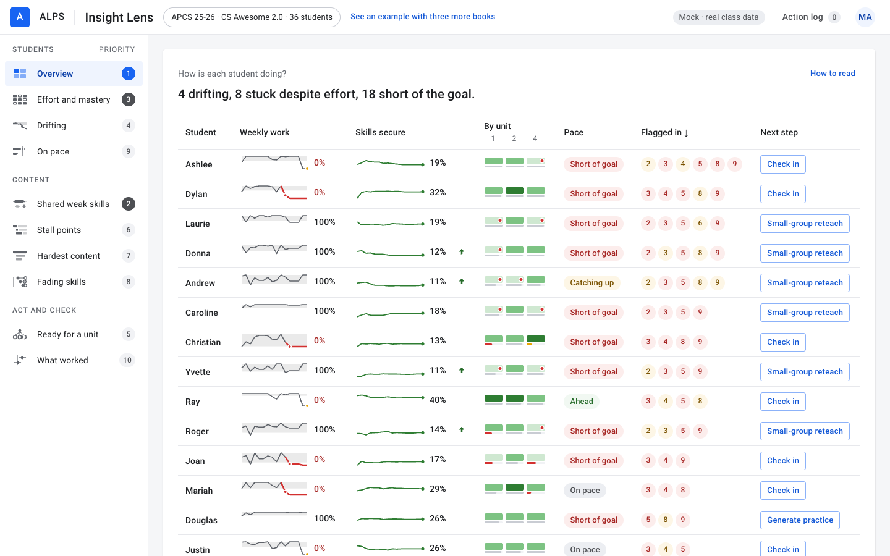

| Component | What is there | Reads as | Can a teacher act? | Verdict and change |
|---|---|---|---|---|
| Answer line | "4 drifting, 8 stuck despite effort, 18 short of the goal." | Three alarms. "Drifting" and "stuck despite effort" are this product's terms, undefined here; "the goal" is 77 skills, set on another page as the class's middle, so by construction about half the class is short of it. | No: no names, no step. | **Simplify.** Say who and what first: "4 drifting (Dylan, Mariah, Christian, Joan): check in. 8 stuck in Data Collections: small-group reteach." Drop "short of the goal" from this line until the goal is a unit (section 4). |
| The table, 36 rows × 7 columns | 1,784 px tall; 14 rows fit a screen; sorted by number of flags. | A gradebook. | Yes, through the Next step column, after scrolling. | **Simplify.** Open on the students with a step to take (24 today), one line a student; fold the other 12 ("12 students with nothing to do first"). Four columns at most. |
| Weekly work: sparkline + figure | 36 sparklines with a gray band and a red segment; 8 figures read "0%", 7 of them red. | "Did nothing this week." It is the share of week 12's class work, the last week in which the class met new questions; the footer says today is week 16. The gray band (the student's normal range) and the red segment are not keyed on this page. | No. | **Simplify.** Put the week in the header ("Week 12's work") and key the band and the red line, or drop the sparkline here (the profile has it) and keep the figure. |
| Skills secure: sparkline + figure + arrow | Figures from 11% to 51%; green arrows on 8 rows. | "19% of skills secure" of an unknown total (it is 100 taught skills), with no class figure beside it (the class average is 27). The arrow means two points or more in four weeks; unkeyed. | No. | **Cut** the sparkline and the arrow from the first look; keep "19 of 100" as text, or leave the figure to On pace. |
| By unit: three cells a student | 108 small pills in three greens, a thin gray or red line under each, a red dot on some; header "By unit 1 2 4". | Green is good, red is bad; the shades, the line and the dot have no key on this page (the Effort page keys them). "1 2 4" under "By unit" can be read as counts. | Clicking a cell opens Effort and mastery on that unit, with the student followed: nobody would guess that. | **Keep** as the one picture per row, and **add the key** above the table (the five marks of the Effort page). Name the units in the header ("Unit 1 · Unit 2 · Unit 4"). |
| Pace: a word in a pill | "Short of goal" 16, "On pace" 11, "Ahead" 7, "Catching up" 2. | Clear words. "Catching up" is the only one that needs a second look (short, but catching up). | No. | **Keep.** Use the same words on the On pace page (see there). |
| Flagged in: numbered chips | 83 chips, "2 3 4 5 8 9" in red and amber. | Scores, or counts, or grades. They are the priorities of the pages that flag the student, and a click opens that page with the student followed. | Only by accident. | **Cut.** Keep the count as the sort order; if a hint is wanted, one word ("6 pages") with the names on hover. |
| Next step: a button | Check in 7, Small-group reteach 7, Talk to them 6, Stretch task 6, Generate practice 4, none 6. | The one thing to do. Clear. "Check in" logs itself as done at once ("Logged: Checked in with Ashlee") and turns into a green "Logged" pill: it reads as "mark done", not "do". | Yes. | **Keep.** Make the button say what it does in this mock ("Log a check-in"), or open the message draft as Drifting does. |
| Sorting by headings | Arrows on the sorted heading. | Standard. | Yes. | **Keep.** |
| How to read | 148 words, opened by a link; the only place the marks of this page are explained. | A paragraph to study. | – | **Simplify** to 40 words once the key is on the page. |
| The following bar (after a chip) | "FOLLOWING Dylan · 3 None of the latest week's work · 4 Drifting since week 11 · 5 4 of 4 gaps · Unit 4 · 8 Slipped on 12 of 33 skills · 9 Short, not catching up · Open profile · Stop following" | A useful one-line summary of a student across pages; the numbers are the rail's priorities again. | Yes: each flag opens its page. | **Keep**; show the page name instead of the number. |

### Effort and mastery · "Who is doing the work, and is it turning into mastery?"

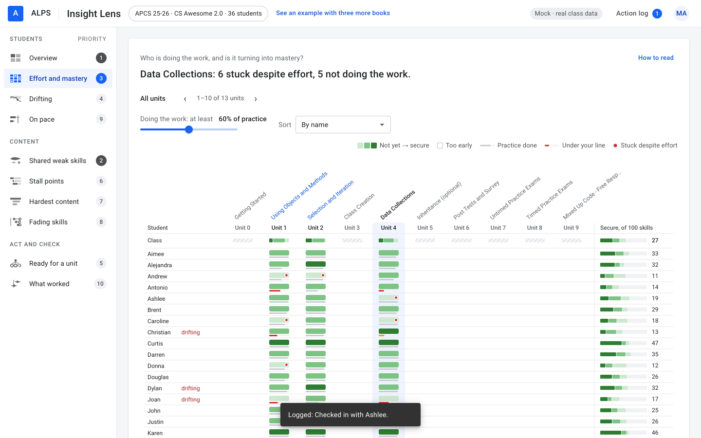

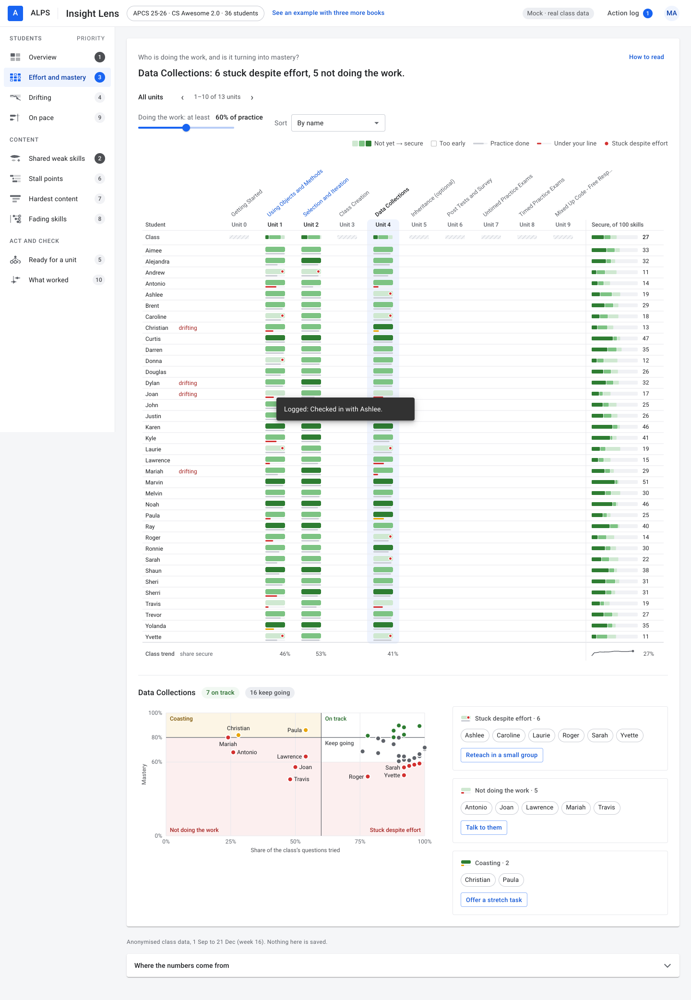

| Component | What is there | Reads as | Can a teacher act? | Verdict and change |
|---|---|---|---|---|
| Answer line | "Data Collections: 6 stuck despite effort, 5 not doing the work." | Concrete: a unit, two numbers. | Not from the line. | **Keep.** |
| Trail and pager | "All units ‹ 1–10 of 13 units ›" | The course has 13 units; the page shows 10 at a time. | Yes. | **Simplify**: with started units only there is nothing to page. |
| Slider "Doing the work: at least 60% of practice" | Moves the line; at 80% the answer becomes "5 stuck, 7 not doing the work". | A setting a first-timer cannot judge, and the first control on the page. | It changes who is in the groups. | **Fold** under a "Your line" link. The default is fine. |
| Sort select | By name, Stuck first, Not doing the work first. | Standard. | Yes. | **Fold.** |
| The key | "Not yet → secure · Too early · Practice done · Under your line · Stuck despite effort" | Five marks, five words: the model for the other pages. | – | **Keep.** |
| The grid, 36 × 10 | 1,057 px; 3 columns started, 7 hatched and empty under gray headings; the signal is 13 red dots and 14 red lines among 108 green pills. | A wall of green; the eye has to hunt for red. The seven empty columns say "nothing here" ten times. | Clicking a heading drills into subunits; clicking a not-started heading (4.1) opens an empty level that says "Nothing to place here yet", a dead end. | **Simplify.** Show started units only ("+10 not started" as a chip, like the profile). Not-started headings are not clickable. Put the grid *under* the picked unit's chart and cards, or fold it ("Every student by unit"). |
| Class row and the per-student summary bar ("Secure, of 100 skills") | A split bar per column and a split bar plus a count per student; "Class trend · share secure 47% 53% 41%" at the foot with arrows. | Three more encodings on the same picture; the trend row needs its own sentence in How to read. | No. | **Cut** the trend row and the per-student bars from the first look; the Class row can stay. |
| The scatter | 36 dots on practice tried × mastery, five named regions, names on the problem dots. | Once the regions are read, "bottom right is stuck, bottom left isn't working" is clear; the region names repeat the cards beside it. | Clicking a dot follows the student. | **Keep** as the page's one picture, above the grid. |
| Three cards | "Stuck despite effort · 6" + names + Reteach in a small group; "Not doing the work · 5" + Talk to them; "Coasting · 2" + Offer a stretch task. | The answer in people and a button each. The best part of the page, at 1,406 px from the top: below the fold. | Yes; logging says "It now waits in What worked as in progress". | **Keep**, first. |
| "drifting" beside a name | A red word on three rows. | A cross-page tag; unkeyed here. | No. | Keep; it is one word. |
| How to read | 225 words, the longest in the mock. | A page of its own. | – | **Simplify** to 60. |

### Drifting · "Who is drifting, and since when?"

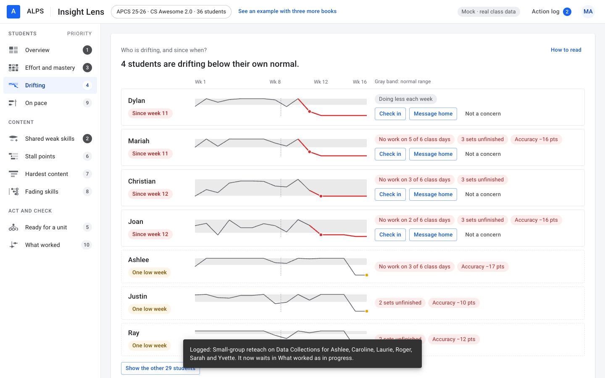

| Component | What is there | Reads as | Can a teacher act? | Verdict and change |
|---|---|---|---|---|
| Answer line | "4 students are drifting below their own normal." | Clear. | – | **Keep.** |
| Axis header | "Wk 1 · Wk 8 · Wk 12 · Wk 16 · Gray band: normal range" | A key, on the page, in nine words. | – | **Keep.** |
| A row a student | Name, "Since week 11", a line that turns red with a dot where it drops, red chips ("No work on 5 of 6 class days", "3 sets unfinished", "Accuracy −16 pts"), three buttons. | "Dropped off at week 11, here is why, here is what to do": the clearest row in the mock. Two things mislead: the dashed vertical at week 8 (the end of the weeks the normal range is taken from) is not keyed; and the red line runs flat from week 12 to week 16, which reads as four weeks of nothing, when weeks 13 to 16 had no class work and carry week 12 forward (How to read says such weeks are "skipped", but they are drawn). "Doing less each week" is shown when no signal fires; it reads as a diagnosis. | Yes. | **Keep.** Stop the line at the last week with class work, or hatch the weeks without any. Key the dashed line or drop it. Replace "Doing less each week" with the figure ("week 12: 0% of class work, normal 60–100%"). |
| Check in · Message home · Not a concern | Check in logs and turns green; Message home opens a draft with Copy text, Mark as sent, Cancel; Not a concern removes the row and offers Undo. | Exactly what they say. | Yes. | **Keep.** This is the pattern for every action in the mock. |
| "One low week" rows | Three rows with dashed borders, an amber pill and a yellow dot, no buttons. | "Watch these": fine, but three more charts to read. | No. | **Fold** into one line: "3 more had one low week: Ashlee, Justin, Ray". |
| Show the other 29 students | 29 mini sparklines with names. | Everyone else is fine. | Clicking one follows the student. | **Keep folded.** |

### On pace · "Is each student on pace to reach the goal?"

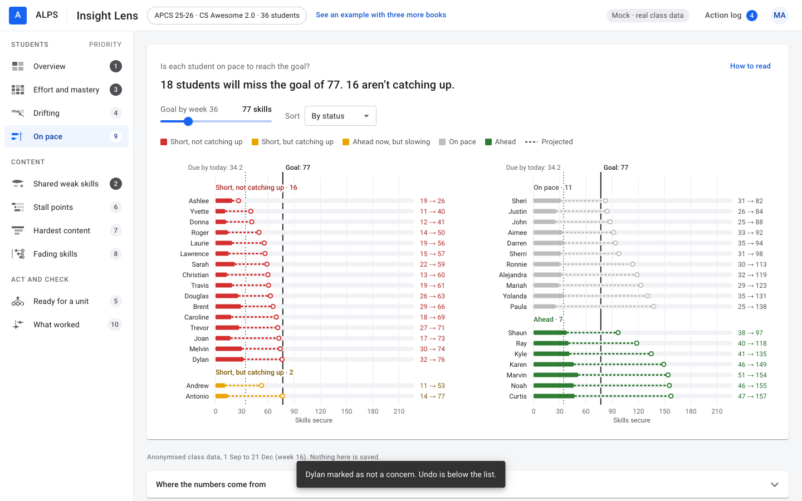

| Component | What is there | Reads as | Can a teacher act? | Verdict and change |
|---|---|---|---|---|
| Answer line | "18 students will miss the goal of 77. 16 aren't catching up." | Half the class is failing. "77" is a number of skills nobody set: the class's own median projection, so half are below it by construction. | No. | **Simplify.** Section 4: make the goal a unit and judge standing by the unit's key skills. Until then, say what the goal is in the sentence: "By week 36, 18 students are projected below the class's middle (77 skills)." |
| Goal slider and sort | "Goal by week 36 · 77 skills"; By status, projection, name. | A setting to fiddle with before the chart is understood. | It redraws everything live. | **Fold.** |
| The key | Five statuses and "Projected". | Five words for one scale: "Short, not catching up", "Short, but catching up", "Ahead now, but slowing", "On pace", "Ahead". The Overview says "Short of goal", "Catching up", "Slowing", "On pace", "Ahead" for the same five. | – | **Simplify**: one set of words on both pages. |
| Two charts side by side | 36 tracks: a solid bar (secure now), a dotted bar (projected), a ring (where it lands), "19 → 26"; a "Due by today: 34.2" line and a "Goal: 77" line on each. | Solid is now, dotted is later: readable after the key. "Due by today: 34.2" is a fraction of a skill. The axis runs to 210 while the largest projection is 157 and most are under 100, so most tracks sit in the left third. | Clicking a track follows the student. | **Simplify.** One chart; open on the two "Short" groups (18 rows) and fold the rest ("18 on pace or ahead"); axis to 160; round "due by today" or drop it. |

### Shared weak skills · "Which skills are many students weak in, and is that changing?"

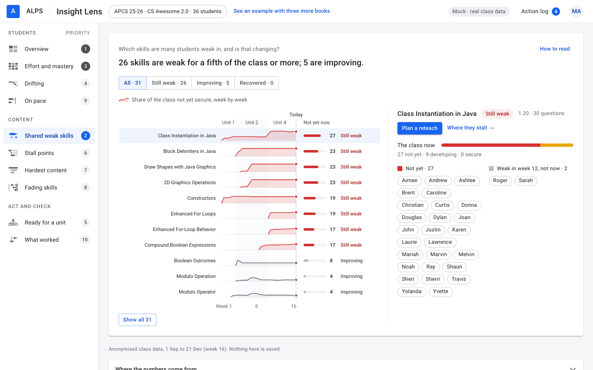

| Component | What is there | Reads as | Can a teacher act? | Verdict and change |
|---|---|---|---|---|
| Answer line | "26 skills are weak for a fifth of the class or more; 5 are improving." | A count, no "which first". | No. | **Simplify**: name the one to reteach first and how many it touches: "Class Instantiation in Java first: 27 of 36 not yet secure." |
| Filter tabs | All · 31, Still weak · 26, Improving · 5, Recovered · 0. | Fine. "Recovered · 0" is a button for nothing. The full list also shows a fourth status, "Getting worse", which has no tab. | Yes. | **Simplify**: hide empty tabs; make the statuses and the tabs the same set. |
| The key | One entry: the red area, "share of the class not yet secure, week by week". | Enough for the picture. | – | **Keep.** |
| A row a skill (11 shown of 31) | Name, a small red area across weeks 1 to 16 under "Unit 1 · Unit 2 · Unit 4" bands and a "Today" line, a bar and a count ("27"), a status word. | "27 not yet secure, and the area rising means getting worse": readable. The status word is printed on every row (11 times on the first screen) when the rows are already grouped by it. | Clicking a row changes the panel. | **Keep** the rows; **cut** the per-row status word and use a group heading instead ("Still weak · 8"). |
| The panel | Skill, status pill, "1.20 · 30 questions", Plan a reteach, Where they stall →, a red/amber/green bar "27 not yet · 9 developing · 0 secure", 27 names. | "1.20 · 30 questions" is a lesson code with no label. The rest is clear and the button is right. | Yes. | **Keep**; label the lesson: "Introduced in 1.20 Unit Summary 1b · 30 questions". |
| Show all 31 | The full list, 1,640 px. | More of the same. | – | **Keep folded.** |

### Stall points · "Where do students stall, skip or give up?"

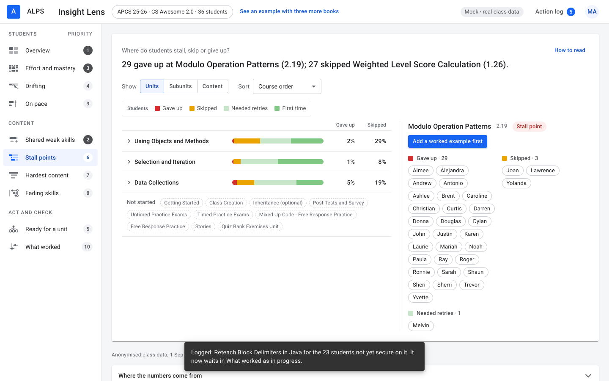

| Component | What is there | Reads as | Can a teacher act? | Verdict and change |
|---|---|---|---|---|
| Answer line | "29 gave up at Modulo Operation Patterns (2.19); 27 skipped Weighted Level Score Calculation (1.26)." | Two questions, two numbers: the most concrete answer in the mock. | Not from the line. | **Keep.** |
| Show Units · Subunits · Content, and Sort | Three levels of the outline. "Content" opens every question of every started unit: 17,709 px, 2,578 words, 434 controls. | At "Units", three pooled bars that say little; at "Content", a wall. The question the headline names is not on the first screen at any level but Content. | Yes. | **Simplify.** Open on the worst questions as one ranked list (five to eight rows: question, lesson, who gave up, who skipped). Keep the outline as the second view, opened one unit at a time. |
| The key | Gave up, Skipped, Needed retries, First time. | Four words, four colours. | – | **Keep.** |
| Unit rows | Three stacked bars with "Gave up %" and "Skipped %": 2% and 29%, 1% and 8%, 5% and 19%. | "29% skipped Unit 1" reads as 29% of students; it is the share of all answers in the unit's questions. | Clicking opens the unit. | **Fold** into the outline view. |
| "Not started" chips | Ten units named in dashed chips. | Noise on a page about where students stall. | No. | **Fold.** |
| The panel | Question, code, "Stall point" pill, one button ("Add a worked example first" or "Make it a required check"), names by outcome. | Clear; the button is a real teaching move. | Yes. | **Keep.** |

### Hardest content · "Which units, subunits and skills are hardest?"

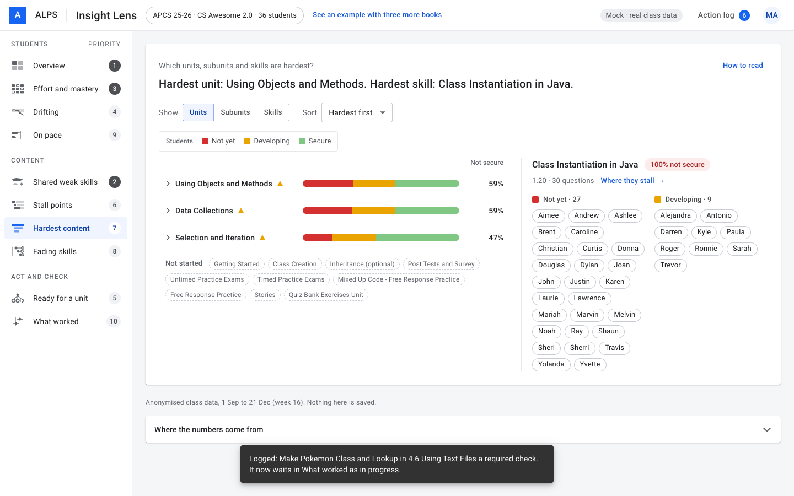

| Component | What is there | Reads as | Can a teacher act? | Verdict and change |
|---|---|---|---|---|
| Answer line | "Hardest unit: Using Objects and Methods. Hardest skill: Class Instantiation in Java." | The same skill, the same 27 students, as Shared weak skills and Fading skills. | No button on this page but "Where they stall →". | **Merge** (section 6): this page is the "by unit" view of the skills page. |
| Show Units · Subunits · Skills, and Sort | "Skills" opens the whole tree: 1,253 words, 219 controls. | Another outline. | Yes. | With the merge, the outline becomes the second view. |
| The key | Not yet, Developing, Secure. | Fine. | – | **Keep.** |
| ▲ beside unit and lesson names | Three on the first screen; the tooltip says "2 skills have no item that checks them". | An alert of some kind; not in the key. It is a note about the item bank, not about the students. | No. | **Cut** from the teacher's view; keep in How to read. |
| Unit rows | Red/amber/green bars with "Not secure 59% · 59% · 47%". | "Most of the class is not secure in every unit": true, and alarming without the time dimension (Unit 1 was taught in weeks 1 to 3; its skills have faded). | – | Merge. |
| The panel | Skill, "100% not secure", lesson, 27 + 9 names, no action. | The same panel as Shared weak skills, minus "Plan a reteach". | Weaker than the sibling page. | Merge. |

### Fading skills · "Which skills fade after they're taught?"

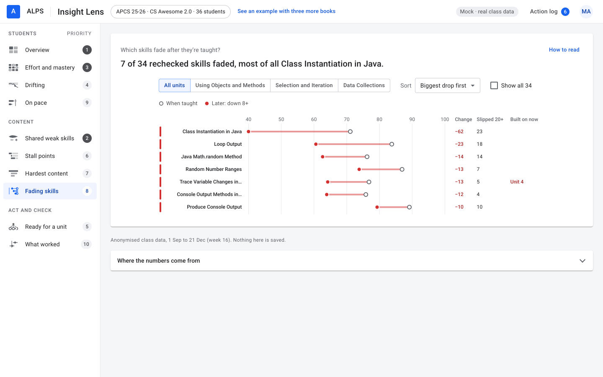

| Component | What is there | Reads as | Can a teacher act? | Verdict and change |
|---|---|---|---|---|
| Answer line | "7 of 34 rechecked skills faded, most of all Class Instantiation in Java." | The third page to name this skill. | Not from the line. | **Merge**, or make the answer carry what only this page knows: "Class Instantiation in Java was 71% when taught and is 10% now: forgotten, not never learned." |
| Unit buttons, sort, "Show all 34" | Four unit buttons, a sort, a checkbox. | Standard. | Yes. | **Fold** the sort; keep the checkbox. |
| The key | "○ When taught · ● Later: down 8+" (+ Steady, Grew when all are shown). | Two marks, enough. | – | **Keep.** |
| Seven rows | Dumbbells from the open dot to the red dot on a 40–100 axis; columns "Change" (−62 …), "Slipped 20+" (23 …), "Built on now" (one entry: "Unit 4"); a red bar at the left of every row. | "Was 71%, now 10%, 23 students slipped": the one insight no other page has. "Built on now" is a cryptic header for a column with one value; the red bars repeat the red dots. | Clicking a row opens the scatter. | **Keep** the picture; rename the column ("Needed in Unit 4"); drop the left bars. |
| The panel | A scatter of every student (when taught across, later up), "Slipped 20+ points · 23" with names, Schedule a review. | Readable with its own labels; the button is right. | Yes. | **Keep.** |

### Ready for a unit · "Is the class ready for each unit, and what first?"

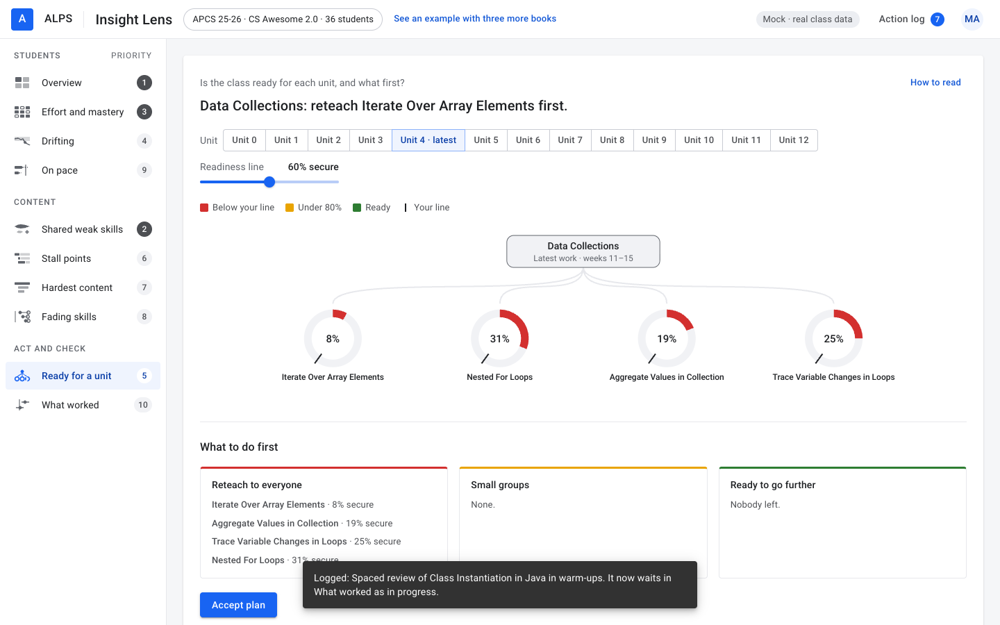

| Component | What is there | Reads as | Can a teacher act? | Verdict and change |
|---|---|---|---|---|
| Answer line | "Data Collections: reteach Iterate Over Array Elements first." | Action first: good. But Data Collections is the unit the class is *in* (weeks 11 to 15), so "ready for" is in the past tense. With Unit 2 picked (finished in week 10) the page says "reteach Modulo Operator first" and lists 12 students "ready to go further" for a unit that is over. | Yes. | **Simplify.** Open on the next unit, and since the data holds no plan, ask: "Which unit do you teach next?" with the started units marked. |
| Unit buttons | 13, "Unit 4 · latest" picked; 9 are not started. | A row of numbers. Here the not-started units are the point. | Yes. | **Keep**; mark started and next. |
| Readiness line slider | 60% secure. | A setting. | It recolours the rings. | **Fold.** |
| The key | Below your line, Under 80%, Ready, Your line (and Not taught yet when it applies). | Four marks, one word each. | – | **Keep.** |
| The tree | The unit in a box, four rings with a percentage and a tick for the line, skill names under them. | "8% of the class is secure on the first thing this unit needs": clear. | Hovering gives the count and the lesson. | **Keep.** |
| What to do first | Three cards: Reteach to everyone (skills with %), Small groups (names), Ready to go further (names, removable); Accept plan, Undo. | The clearest "what can I do" block in the mock. | Yes; "Plan accepted. 4 actions logged." | **Keep.** |

### What worked · "Did what I did work?"

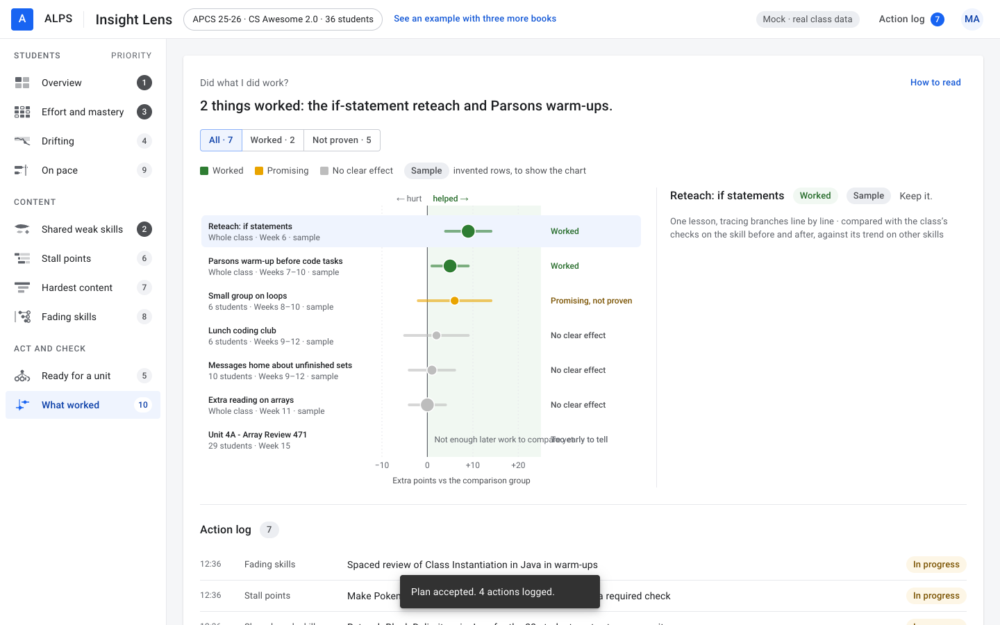

| Component | What is there | Reads as | Can a teacher act? | Verdict and change |
|---|---|---|---|---|
| Answer line | "2 things worked: the if-statement reteach and Parsons warm-ups." | Two successes. Both are invented sample rows; the one real row (Unit 4A Array Review, week 15) is "too early to tell". | No. | **Simplify.** The headline must count real rows only: "Too early to tell for the one set you targeted (Unit 4A Array Review, week 15)." |
| Filter and key | All · 7, Worked · 2, Not proven · 5; Worked, Promising, No clear effect, "Sample · invented rows, to show the chart". | The key says sample rows are invented; the headline says they worked. | – | Keep the key; fix the headline. |
| The chart | Seven rows: a dot and a range on a −10 to +25 axis, "← hurt · helped →", a verdict word; six rows marked "sample" in small gray type. On the real row, "Not enough later work to compare yet" (x 625–826) runs into "Too early to tell" (x 793–875). | Readable; the two texts overlap. | Clicking a row opens the panel. | **Simplify**: fence the sample rows off (dashed box, "invented") or hide them behind "Show sample rows"; fix the overlap. |
| The panel | Name, verdict, "Sample", a recommendation ("Keep it."), the dose and the comparison. | Clear. | – | Keep. |
| Action log | Time, page, text, "In progress" or "Done" for everything logged. | Exactly what was done today. | – | **Keep**, and make it the page: "My actions", with the effect chart appearing when a real set has later work. |
| Sample rows elsewhere | 18 of 36 real profiles show an invented moment ("Messages home about unfinished sets (sample)"); with Brent followed, "Brent did this" appears under invented rows. | Invented facts about real students. | – | **Cut**: never attach a sample row to a student. |

### A profile

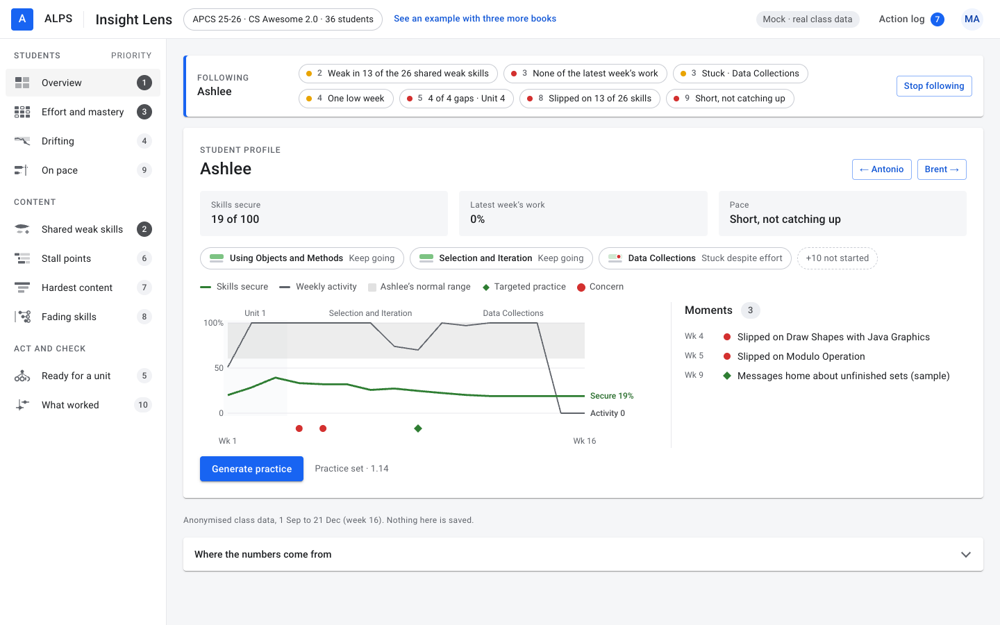

| Component | What is there | Reads as | Can a teacher act? | Verdict and change |
|---|---|---|---|---|
| The following bar | Up to seven flags with priority numbers; Open profile; Stop following. | A good summary; the numbers again. | Yes. | Keep; page names, not numbers. |
| Three figures | "Skills secure 19 of 100", "Latest week's work 0%", "Pace: Short, not catching up". | Clear, except which week "latest" is. | – | Keep; name the week. |
| Unit chips | "Using Objects and Methods · Keep going", "Selection and Iteration · Keep going", "Data Collections · Stuck despite effort", "+10 not started", each with the grid's small mark. | Where the student is in each unit, in words: good. The small marks are unkeyed here. | Clicking opens the grid on that unit. | Keep; the words carry it. |
| The timeline | One chart: secure share (green), weekly activity (gray), the normal band, unit bands, moments as dots; a five-entry key. | One picture, keyed: the model. The activity line falls to 0 at week 13 and stays there to 16 for the same reason as on Drifting. | Hovering a dot gives the moment. | Keep; same fix as Drifting. |
| Moments | "Wk 4 Slipped on …", "Wk 5 Slipped on …", "Wk 9 Messages home about unfinished sets (sample)". | A short history; the invented one reads as real. | – | Cut sample moments. |
| Generate practice | A set of one item ("1 item · about 3 min"), time buttons, remove, "Why these items" (six items left out as too hard or broken), Assign. | A thin set, honestly explained. | Yes. | Keep. |

### Across the pages

| Component | What is there | Reads as | Verdict and change |
|---|---|---|---|
| The rail | Three groups; numbers 1, 3, 4, 9 · 2, 6, 7, 8 · 5, 10 in badges; "PRIORITY" in small capitals; a one-line purpose for each page on hover ("Priority 3 of 10: who needs a reteach, and who needs a nudge"). | Badges with counts, out of order. The one-line purposes, the best short explanation of each page, are hidden in a hover. | **Cut the numbers**; the order can carry the priority. The purposes belong in a first-visit hint, not a hover. |
| Top bar | Class name; "See an example with three more books" (a blue link); "Mock · real class data"; Action log; avatar. | The link and the chip are demo chrome; a teacher does not know what an "example with three more books" is. | **Fold** the demo link into the footer; drop "Mock · real class data" for teacher-facing demos. |
| How to read | On every page; 1,021 words in all; on the Overview it is the only key. | Homework. | ≤ 50 words a page; marks keyed on the page. |
| Footer | "Anonymised class data, 1 Sep to 21 Dec (week 16). Nothing here is saved." | The only place "today" is defined. | Keep; add "latest class work: week 12". |
| Where the numbers come from | A table of pages, formulas and database tables, collapsed. | For the builder. | Keep collapsed; rename the "Database tables" column away from the teacher view. |
| Tooltips | Sixty or more on the Overview alone. | Extra, never the only explanation on nine pages; the only one on the Overview. | Keep as extra. |
| Phone width (390 px) | The Overview shows three of seven columns; Next step is off-screen; the class name is "AP…"; Shared weak skills and Ready for a unit scroll sideways. | Not usable for a scan. | Decide the scope (section 6). |

## 3. Vocabulary

Status words a teacher meets on the first screens, by page. Each is a term to learn.

| Page | Words |
|---|---|
| Overview | drifting, stuck despite effort, short of the goal, catching up, ahead, on pace; Check in, Small-group reteach, Generate practice, Talk to them, Stretch task |
| Effort and mastery | not yet, secure, too early, practice done, under your line, stuck despite effort, on track, keep going, coasting, not doing the work |
| Drifting | since week N, one low week, doing less each week, no work on X of Y class days, sets unfinished, accuracy −N pts, not a concern |
| On pace | short not catching up, short but catching up, ahead now but slowing, on pace, ahead, projected, due by today, goal |
| Shared weak skills | still weak, getting worse, improving, recovered, not yet now, not yet, developing, secure |
| Stall points | gave up, skipped, needed retries, first time, stall point, often skipped |
| Hardest content | not yet, developing, secure, not secure, no item checks it, too few checked yet |
| Fading skills | when taught, later, down 8+, steady, grew, slipped 20+, built on now, change |
| Ready for a unit | below your line, under 80%, ready, your line, not taught yet, reteach to everyone, small groups, ready to go further |
| What worked | worked, promising, no clear effect, too early to tell, sample, hurt, helped |

About sixty terms. The same idea has up to five names: a student who is not secure is "not yet", "not secure", "below your line", "slipped", "faded"; a student doing poorly on pace is "short of goal" here and "short, not catching up" there. One shared set would do: **secure · developing · not yet** for a level; **doing the work · not doing the work** for effort; **drifting**; **stuck**; **short of the goal**; **ready · not ready**. Everything else is a page's own refinement and can live in its panel.

## 4. Pace: count the skills that matter, and set the goal in units

Two points you raised, in your words: a teacher takes a student to know a unit when they are proficient in, or have mastered, its hard skills, not when they have secured some number of skills; and the goal is a unit, not a count. Both are right, and the numbers below, worked out on this class from the page's own levels, say how much they change.

### What the page does today

- **Every taught skill counts alike.** The class has met 100 skills in 16 weeks; the page continues that rate to 225 by week 36 and sets the goal at 77, the class's median projection. A student's status comes from the count secure now against "due by today" (34.2) and the recent rate.
- **So a student secure on twenty easy skills outranks one secure on a unit's eight hard ones**, half the class is short of the goal by construction, and "77" is nobody's target. The Overview repeats it ("18 short of the goal"), the profile shows "Skills secure 19 of 100", and the grid's cells average mastery over every listed skill of a unit the same way.
- **The rate is read from weeks 10 to 16**, four of which had no class work, so the projection says more about the calendar than about the student.

### Which skills are a unit's key skills

Three ways to pick them, measured on this class. "Listed" is every skill the unit's lessons name in the export.

| Rule | What it takes | Unit 1 | Unit 2 | Unit 4 (in progress) | Unit 3 (not started) |
|---|---|---|---|---|---|
| Skills listed | everything the unit's lessons name | 73 | 77 | 152 | 53 |
| A · Assessed | skills the unit's own summary, test, exercise and practice lessons check (10 of unit 1's 27 lessons, 15 of unit 2's 31, 24 of unit 4's 71) | 21 | 33 | 50 | 18 |
| B · Carried forward | skills two or more lessons name and three or more questions check, or that a later unit builds on | 25 | 37 | 63 | 20 |
| **A and B · key skills** | assessed by the unit, and carried forward | **14** | **18** | **32** (8 checked so far) | **14** |
| … of which hard | the bottom third of the key skills by the class's share secure | 5 | 5 | 3 | – |
| C · Hardest alone | the bottom third of all the unit's checked skills | 9 | 13 | 8 | – |

The book's own tests say what a unit is for; reuse says the skill carries forward; together they give a short list a teacher would recognise. Unit 1's fourteen: Modulo Operation, Produce Console Output, Output Statements, Modulo Operator, Constructors, Java Class Definition, Draw Shapes with Java Graphics, Substring Operations, String Comparison Methods, Compare Java String References, Class Instantiation in Java, Calculate Aggregated Values from Data, Aggregate Values in Collection, Method Return Type. Its hard five: Class Instantiation in Java (0% of the class secure), Constructors (8%), Draw Shapes with Java Graphics (13%), Aggregate Values in Collection (21%), Java Class Definition (22%). Unit 2's hard five: Methods in Classes, Trace Variable Changes in Loops, Loop Output, Nested For Loops, Modulo Operator.

"Hardest by results" alone (rule C) is circular for a goal: a skill nobody has would be required because nobody has it. It is the right lens for *mastered*, not for picking the list. The list should be the teacher's to edit: a tick-list a unit, starting from A and B.

### Standing in a unit, from its key skills

Four words, from the key skills the class has been checked on so far: **mastered** (secure on 90% or more), **proficient** (secure on 60% or more and "not yet" on 25% or fewer), **developing** (secure on 30% or more, or "not yet" on half or fewer), **not yet**. Against the grid's current cell, which averages every listed skill:

| Unit | Today's cell: secure · developing · not yet | By key skills: mastered · proficient · developing · not yet |
|---|---|---|
| Unit 1 · Using Objects and Methods | 7 · 22 · 7 | 0 · 8 · 23 · 5 |
| Unit 2 · Selection and Iteration | 12 · 23 · 1 | 5 · 9 · 20 · 2 |
| Unit 4 · Data Collections (in progress, 8 of 32 key skills checked) | 9 · 19 · 8 | 0 · 10 · 25 · 1 |

Eighteen students are proficient in no unit yet, eight in one, six in two, four in all three started units. The hard skills can gate the standing (proficient only when no hard key skill is "not yet"): then nobody is proficient in Unit 1 or 2 today, because Class Instantiation in Java is "not yet" for 27 of 36. So the gate belongs on **mastered**, not on **proficient**, or the page empties.

### The goal in units, and pace by standing

**Goal: "Proficient through Unit N by a date."** The default is the unit the class is in and the end of the year; the units on offer are the book's, started ones marked.

**Pace by standing, not by rate.** The class's own schedule is the plan: it has finished Units 1 and 2 and is in Unit 4. A student is **on pace** when proficient in every finished unit, **behind in one unit** or **behind in two** otherwise, **ahead** when mastered in all of them. Nothing is projected; the gap is a number a teacher can act on ("six key skills to close in Unit 2") and it is the reteach list.

| | Students |
|---|---|
| On pace (proficient in Units 1 and 2) | 6 · Dylan, Marvin, Noah, Ray, Ronnie, Shaun |
| Behind in one finished unit | 10 |
| Behind in two | 20 |

Against the page today: of the 11 it calls "On pace", one is on pace by standing; of the 7 "Ahead", four; and Dylan, "Short, not catching up" by rate, is proficient in both finished units and is simply drifting now, which is the Drifting page's finding, not this page's. The two readings disagree because they answer different questions: the count asks how fast a student is collecting skills, the standing asks whether they have the units the class has done.

**Why not project to the date.** The goal through Unit 4 holds 68 key skills, of which the class has met 34; the other 34 are in lessons not yet taught. A projection from each student's rate over the 12 class weeks, continued for the 15 class weeks left, reaches the 68 for nobody, because it guesses at units the class has not reached. The date belongs to the class's plan ("at the class's pace so far, Unit 3 and the rest of Unit 4 come by about week 28"), and a student is measured against what the class has finished.

### The page, sketched

```
ON PACE · Is each student on pace to be proficient through Unit 4 by the end of the year?
6 on pace · 10 behind in one finished unit · 20 behind in two.
Goal: proficient through [Unit 4 ▾] by [5 Jun ▾]       Key: ▆ mastered  ▆ proficient  ▆ developing  ▆ not yet   n = key skills to close

              Unit 1 (done)      Unit 2 (done)      Unit 4 (now)       Unit 3 (later)
Andrew        ▆ not yet · 11     ▆ not yet · 9      ▆ not yet · 5      ·            Behind in two units   [Reteach list]
Ashlee        ▆ developing · 7   ▆ developing · 6   ▆ developing · 3   ·            Behind in two units
…
Marvin        ▆ proficient · 2   ▆ mastered         ▆ proficient · 1   ·            On pace
Class         0 · 8 · 23 · 5     5 · 9 · 20 · 2     0 · 10 · 25 · 1
```

One row a student, one cell a unit of the goal, the standing's colour and the number of key skills to close; sorted by units behind; the class row at the foot. It reuses the Overview's "By unit" cells, so the two pages say the same thing, and the grid's cells can adopt the same standing (a decision below). The Overview's answer becomes "30 students are behind in a finished unit", its Pace word becomes "On pace / Behind in 1 / Behind in 2", and the profile's "Skills secure 19 of 100" becomes "Proficient in 1 of 3 units · 6 key skills to close in Unit 2".

### Decisions in this section

1. **Which skills are key.** A and B by default, as above, with the list editable by the teacher; or the book's tests alone (A: 21, 33, 50 a unit, broader); or add the hardest by results.
2. **The thresholds.** Proficient at 60% secure and 25% not yet, mastered at 90%. At 50% secure the proficient count rises (Curtis, Yolanda and Trevor become proficient in all three started units).
3. **The hard-skill gate.** On mastered only (proposed), or on proficient too, which empties the page today.
4. **Pace by standing** (proposed) or a projection to the date; a projection can be added for the units the class has reached, never through the ones it has not.
5. **One standing everywhere.** Whether Effort and mastery's cells and the Overview's unit cells adopt the key-skill standing, so a unit is "proficient" on every page for the same reason.

### Limits of these numbers

- The key skills of a unit the class has not reached come from the book's lesson lists; the ones it has been checked on grow as the unit is taught (Unit 4: 8 of 32 so far), so a standing in the current unit is provisional and should say so.
- Which lessons count as a unit's tests was read from their names (summary, test, exam, exercises, practice, FRQ); the book has no field for it.
- The thresholds are mine, chosen so that today's class is spread across the four words; they are the first thing to try on a second class.

## 5. The first-look set

What I would keep on the first screens, so that a teacher new to the pages can go through them in about two minutes, and what the rest becomes.

| Page | First screen | Folded one click away | Time |
|---|---|---|---|
| Overview | The answer with names; the students with a step to take, one line each: name, why (one phrase), one picture (the three unit cells, keyed), the button | The other students; sparklines; sorting | 25 s |
| Effort and mastery | The answer; the picked unit's scatter and its three cards | The grid (started units only); the line; the sort | 15 s |
| Drifting | As it is, with the break weeks hatched | "One low week" rows; the other 29 | 15 s |
| On pace | The goal in units; one row a student with a cell a unit and the number of key skills to close (section 4) | The unit and date pickers; the key-skill lists | 12 s |
| Skills (Shared weak + Hardest + Fading as one page) | The answer; the weak-skill rows grouped by status, each row with "was N% when taught" where it faded; the panel with Plan a reteach | The outline by unit; the fading dumbbells; the scatter | 20 s |
| Stall points | The answer; the worst five to eight questions as a list; the panel | The outline; "Not started" | 15 s |
| Ready for a unit | "Which unit next?"; the tree; the three cards | The slider; past units | 15 s |
| My actions (What worked) | The log | The effect chart, when a real set can be judged; sample rows, fenced | 8 s |
| A profile | As it is, without sample moments | – | 12 s |
| | | | **≈ 137 s** |

Two sketches.

```
OVERVIEW · How is each student doing?
4 drifting · 8 stuck despite effort in Data Collections        Key:  ▆ secure  ▆ developing  ▆ not yet
                                                                     ▬ practice done  ▬ under the line  ● stuck
Needs a step first · 24
Student    Why                                   Units 1 · 2 · 4    Next step
Ashlee     Stuck in Data Collections              ▆ ▆ ▆●            [Small-group reteach]
Dylan      Drifting since week 11                 ▆ ▆ ▆             [Check in]
Laurie     Stuck in Unit 1 and Data Collections   ▆●▆ ▆●            [Small-group reteach]
…
▸ 12 students with nothing to do first · 6 ahead
```

```
EFFORT AND MASTERY · Who is doing the work, and is it turning into mastery?
Data Collections: 6 stuck despite effort, 5 not doing the work.
[Unit 1] [Unit 2] [Unit 4 ●]  +10 not started

 Mastery ▲                            │  Stuck despite effort · 6
   Coasting      │  On track           │  Ashlee Caroline Laurie Roger Sarah Yvette
                 │  Keep going         │  [Reteach in a small group]
 ────────────────┼───────────────────  │
   Not doing     │  Stuck despite      │  Not doing the work · 5
   the work      │  effort             │  Antonio Joan Lawrence Mariah Travis   [Talk to them]
                 └──────────► practice │  Coasting · 2 · Christian Paula        [Offer a stretch task]
▸ Every student by unit
```

## 6. Decisions that are yours

1. **One skills page or three.** Shared weak skills, Hardest content and Fading skills answer three questions with one list of skills. One page with "by status", "by unit" and "faded" views reads once; three pages read three times. The separate answers are worth keeping only if each page's first sentence says something the others do not (section 2 has the sentence Fading could say).
2. **The rail's numbers.** Remove them and let the order carry the priority, or keep them and accept that first-timers read them as counts.
3. **What "now" is.** The latest week with class work is 12; the footer says 16. Either every figure names its week ("week 12's work") or the four quiet weeks are shown as quiet (hatched) wherever a line runs through them.
4. **Not-started units.** Hide them on the grid, the outlines and the overview by default, with a "+N not started" chip; keep them only on Ready for a unit, where the future is the point.
5. **The goal on On pace.** Section 4 has the five choices: which skills count as a unit's key skills, the thresholds for proficient and mastered, whether the hard skills gate them, pace by standing or by projection, and whether the grid and the overview adopt the same standing.
6. **Invented rows.** Keep the sample rows only inside a clearly fenced box on What worked, never in a headline, a profile or a following mark; or drop them until a real targeted set has later work.
7. **The Overview's shape.** A table of all 36 students (as now) or a list of the 24 with a step first. The second is faster; the first is what a gradebook-minded teacher expects.
8. **Phones.** Out of scope for the scan, or a stacked layout for the Overview and the two pages that scroll sideways.
9. **The demo chrome.** The example link and the "Mock" chip are for us; decide whether a teacher-facing demo shows them.

## 7. What this review did not do

- It judged the pages on one real class with one book. The example with three more books adds a Book row to every page (31 more words on the Overview) and was not re-reviewed here beyond that.
- It did not test with a teacher. "Reads as" is my reading of each component at first sight, backed by the counts, not an observation of someone else's.
- It did not time the scan with a stopwatch; the times are words divided by a scanning pace of four a second, which is generous for pictures that need a key.
- It did not review the tooltips' wording one by one (there are more than sixty on the Overview alone) or the "How to read" texts for accuracy, only for length.

## 8. Afterword: what was built

On 13 October 2026, after this review was read, the proposals of sections 2, 4 and 5 were built on branch `version2`. Where section 6 left a decision open, the option this review marked as proposed was taken; they are listed below so that each can be reversed. The checker (`node tools/check.js --checks`) passes: seven of its checks were rewritten because the rules they held were reversed on purpose, and fourteen were added for the new rules.

### Before and after

Both versions were measured the same way: the words in the text of the page's view (chart labels included) that sit in the first 900 px at 1440 × 900, the controls there, "How to read" as written, and the page's height. The table in section 1 counted the whole window, so its "before" numbers are larger than the ones here; the two columns of this table are comparable with each other.

| Page | Words on the first screen | How to read | Controls visible | Page height |
|---|---|---|---|---|
| Overview | 197 → 189 | 148 → 51 | 92 → 29 | 2,147 → 1,663 px |
| Effort and mastery | 148 → 151 | 225 → 53 | 15 → 22 | 2,083 → 990 px |
| Drifting | 153 → 139 | 53 → 50 | 21 → 21 | 1,085 → 900 px |
| On pace | 239 → 275 | 96 → 52 | 39 → 25 | 942 → 1,481 px |
| Skills, weak now (was Shared weak skills) | 198 → 212 | 102 → 53 | 48 → 51 | 970 → 1,206 px |
| Skills, by unit (was Hardest content) | 149 → 116 | 73 → 47 | 45 → 48 | 900 → 925 px |
| Skills, faded (was Fading skills) | 91 → 101 | 92 → 50 | 14 → 16 | 900 → 900 px |
| Stall points | 142 → 149 | 74 → 48 | 42 → 45 | 959 → 955 px |
| Ready for a unit | 132 → 140 | 84 → 49 | 16 → 16 | 1,067 → 1,055 px |
| My actions (was What worked) | 190 → 109 | 74 → 47 | 11 → 3 | 987 → 900 px |
| A profile | 110 → 134 | – | 7 → 8 | 900 → 900 px |
| **All eleven screens** | **1,749 → 1,715** | **1,021 → 500** | **350 → 284** | |
| **The eight pages a teacher opens, and a profile** (one view of Skills) | **1,749 → 1,498** | | | |

What the numbers say, and what they do not:

- **The words on the first screens barely moved.** Most of them are names: the Overview's 24 rows, the pace table's 36, the 27 students in the Skills panel. A page whose answer is who is behind cannot get under 80 words, so that budget in section 1 was wrong for pages whose answer is a list of people; count the names apart. What changed is what the words are: a name, one phrase and a button, instead of chart labels, numbered chips and status words.
- **"How to read" is half the length** (fifty words or so a page, sixty on the grid), and no page's picture depends on it any more: every mark is keyed on the page.
- **Ten pages became eight**, and the three that named the same skill are one page with three views.
- **The two tallest pages halved.** The Overview opens on the 24 students with a step to take first, not all 36; Effort and mastery opens on one unit's chart, with the grid folded under it.
- **On pace grew**, in words and in height: it shows all 36 students, one row each, with a number a cell, and has no projection, no second chart and no slider.
- **The controls are mostly names** (every name is a button that follows the student). Without them, the Overview went from 92 to 29 and My actions from 11 to 3.

### What was built, page by page

- **Overview.** The answer names who: "4 drifting (Christian, Dylan, Joan and Mariah). 4 stuck despite effort, most in Using Objects and Methods: small-group reteach. 30 behind in a finished unit." Then the key, and one line a student who needs attention first: name, why (the worst thing a page found, in the order of the steps: drifting, stuck or not doing the work, behind, then the content pages), the three unit cells (headed "Unit 1 · Unit 2 · Unit 4"), the button where one fits. Twelve students are folded ("Show the other 12 students · 8 behind in one unit"). The sparklines, the "Skills secure" column, the pace column and the 83 numbered chips are gone.
- **Effort and mastery.** A row of buttons for the started units ("+10 not started" beside them), the key, then the unit's scatter (the share of its key skills secure, up; the share of its questions tried, across) with the three cards and their buttons beside it. The grid is a fold under that ("Every student, by unit"), started units only, with the line and the sort inside the fold; the per-student summary bars and the trend row are gone. The grid's cells, the overview's cells and a profile's chips now show the same standing.
- **Drifting.** The weeks with no class work are hatched and the line stops at the last week that had some; the dashed week-8 line is gone; "Doing less each week" became "Week 15: 0% of class work, normal 63–100%"; the three "one low week" students are one line of names. A profile's timeline is drawn the same way.
- **On pace.** "Goal: proficient through [Unit 4 · Data Collections (now)] by [4 May (week 36)]", two selects, with a sentence on when the class's own pace reaches it. One row a student, a cell a unit of the goal in the standing's green with the number of key skills still to close, sorted by units behind; the class divided at the foot. The answer: "6 on pace · 10 behind in one finished unit · 20 behind in two." A finished unit is one before the unit the class is in, in the main book; a unit of labs is never one; too early to tell is not behind.
- **Skills.** One page, three views. *Weak now*: the answer names the skill to reteach first ("Class Instantiation in Java first: 27 of 36 not yet secure"), the rows run under a heading a status (getting worse, still weak, improving, recovered) with no status word on each row, a skill that faded says what it fell from ("faded: 71% → 10%"), empty statuses have no tab, each row's line is the share of the students checked on the skill who are secure, drawn upward so a hard skill sits low or falls, and a row's status comes from that line over the last 30 days of class work (changed later on request, so that lower reads as worse; the earlier "getting worse", read from the share of the whole class not yet secure, mostly flagged skills the class had only just met), a day picked on a line lists who was where then, a second day on the same skill sorts the class by change (lost it, reteach group, still developing, got it, held) and a day on another skill gives who is not yet on both (added on request; buttons only on today's lists, and a past day offers "Compare with now"); a day also lists the questions its struggling students are getting wrong, and two days list what the students who were doing better got wrong in between (on Class Instantiation, 18 of the 22 who were better on 10 Sep got the Unit 4 question "Community Class Object Array" wrong: the skill broke when it met arrays), and the panel opens with a card a teacher can check at a glance, "Introduced in · Unit 1 · Using Objects and Methods · 1.20 Unit Summary 1b (1.7-1.15) · First met on 9 Sep · 30 questions check it", which opens the grid at that subunit with the skill picked (added later the same day on request; the by-unit and faded views have the same card). *By unit* is the old Hardest content without the ▲ marks and with the not-started units as one count. *Faded* is the old Fading skills with "Needed in Unit 4" as the last column, no left bars and no sort. `#hardest` and `#fading` still open their view.
- **Stall points.** Opens on the eight questions where the most students gave up or skipped, ranked, each with its lesson code; the outline is the second view, with "+10 not started" as one line.
- **Ready for a unit.** Asks "Which unit do you teach next, and is the class ready for it?", picks the first unit not started after the one the class is in (Unit 5 here) and says so, marks the started units "done" and "now", and folds the readiness line under the plan. Later, on request, the tree became two levels deep, from the learner model's skill graph, with a taught symbol under each skill (see below).
- **My actions.** Opens on the log of everything done today, then "Did the practice sets work?" for the real set, with the headline counting real sets only ("Too early to tell for the one set you targeted"). The six sample rows sit in a fold of their own, marked invented, with no names in their panel; they reach no headline, no profile moment, no flag and no "did this" mark.
- **A profile.** "Proficient or better: 2 of 3 units", "Class work, week 15", "Pace: Behind in 1 unit · 6 key skills to close in Unit 1"; the unit chips carry the standing words; the moments have no sample rows.
- **Across the pages.** The rail has no numbers (its order is the priority); the "Mock · real class data" chip is gone and the example link lives in the footer; the following bar's flags name their page on hover; the footer says "the latest class work is from week 15"; the example with three more books still works on every page.

### The decisions taken

From section 4 and section 6, in their order; each is mine until you say otherwise.

1. **One skills page**, with the by-unit and faded views one click away.
2. **The rail's numbers removed**; the order carries the priority.
3. **"Now"**: every weekly figure names its week, the quiet weeks are hatched wherever a line runs through them, and the footer says which week the latest class work is from.
4. **Not-started units** are counted, not shown, except on Ready for a unit.
5. **The goal and the standing**: key skills are A and B (assessed by the unit's own tests and carried forward), proficient at 60% secure and 25% not yet, mastered at 90% with the hard-skill gate on mastered only, pace by standing with nothing projected, and one standing on every page.
6. **Invented rows** stay, fenced off, and never touch a headline, a profile or a following mark.
7. **The Overview** is the list of students with a step first. "Behind in one unit" is a step but not a first one, so those students are in the fold with their button.
8. **Phones** are out of scope; the pages still fit 390 px, with the tables and the charts scrolling sideways.
9. **Demo chrome**: the "Mock" chip is gone, an "Example" chip shows only while the example is on, and the way to the example is in the footer.

### The actions, narrowed

After the build, the actions were limited to the four things the product can do: a reteach, coursework (a set built from the item bank, by skill or by item type), content to practice, and a group. Nothing is sent, launched, marked or changed in the course, and a page offers a button only where one of the four fits.

| Where | Was | Now |
|---|---|---|
| Overview, a drifting student | Log a check-in | No button; the row says why, and the student stays in the first list because the flag is red |
| Overview and Effort, not doing the work | Talk to them | Assign the practice (the unit's own work, as content to practice; the labs, under a book of labs) |
| Overview, Effort and Ready, coasting or ahead | Stretch task | Stretch set (coursework) |
| Drifting | Check in · Message home (with a draft) · Not a concern | No buttons; the page says who, since when, and the signals |
| Skills, weak now | Plan a reteach | Reteach |
| Skills, faded | Schedule a review | Give a review set (coursework, as a warm-up) |
| Stall points, gave up | Add a worked example first | Reteach this |
| Stall points, skipped | Make it a required check | Assign it as coursework |
| My actions, sample rows | Lunch coding club · Messages home about unfinished sets | Extra practice sets on loops · Pair work on unfinished sets (both invented, as before) |

Unchanged: Small-group reteach and Reteach in a small group (a group and a reteach), Generate practice and Assign (coursework by skill), the readiness plan's Reteach to everyone and Small groups. A check now holds this.

### Dates, not weeks (later the same day)

Two more decisions came after the actions: weeks are not relevant, and students may keep working on earlier parts at any time. Four answers set the design: today is the export date; nothing assumes a class day or a timetable; catching up shows on the profile only; "recent" is the latest continuous five days.

What changed:

- **Today is the export date** (13 October 2026 for this export, whose work runs to 5 February 2026), and the footer says so, with the day of the latest work. An "As of" date picker under the answer on every page (`index.html?today=YYYY-MM-DD`) re-reads them as of another day, with a way back to today; it is a way to look back, not an assumption, and it is how a page that says "no class work in the last five days" is read for the days the class was working. For the demo, the Drifting page opened without a day moves to the latest day it can judge, so it never opens empty; the address shows that day.
- **Every figure is a date.** "Drifting since 14 Nov", "First met on 24 Sep", a unit "worked on 10 Nov to 8 Dec", a skill checked again "21 days or more later", the pace goal "proficient through Unit 4 by [a date picker]", and the class-plan sentence in dates ("3 units between 3 Sep and 5 Feb 2026; the 5 units of this goal take until about 21 May 2026").
- **Time runs in five-day blocks counted back from today**, so the latest block is always the last five days. A block in which nobody in the class worked is a break, read from the data, hatched on the charts, and left out of every rule. The charts run from the first day of work to a little after the latest, so an idle tail does not squeeze them.
- **Effort is any work.** A student's work in a block is the questions they first tried in it, on any unit, so catching up on Unit 2 in December is working. Their normal is the middle of their earlier live blocks (the latest two left out); low is under half of it.
- **Drifting is judged against the class.** A student is drifting when they are low in the last five days and in the live block before, and only while classmates are not low too. When nobody in the class worked in the last five days, or half the class or more is low, the page says so ("The class as a whole is working less: 29 of 36 are under half their normal in the five days to 19 Dec") and singles out nobody.
- **The profile says "Catching up: 45 questions on Unit 2, the latest on 15 Dec"** or "Working ahead: …"; the Overview does not mention it.
- **A picker with many options is one select, never a row of buttons** (asked for later the same day, on seeing 35 unit buttons under three book rows on Ready for a unit in the example). The unit on Effort and mastery, the next unit on Ready for a unit, the unit filters on Skills, the goal unit on On pace and the Book filter are selects; with several books the units are grouped by book inside the select. The view switches and the status tabs stay as buttons: they have two to four short options.
- **A time axis carries dates only.** The unit bands over the Skills chart and the profile's timeline are gone: a student may redo an earlier unit's work at any time, so a unit cannot be placed on a date axis. The Skills page filters by unit instead ("Through Unit 2" shows the skills introduced up to that unit, with their whole history).

What it shows on this class, read as of three days:

| As of | Drifting page says |
|---|---|
| 13 Oct 2026 (the export date) | No class work from 9 Oct 2026 to 13 Oct 2026; the latest was on 5 Feb 2026. Nobody judged. |
| 19 Dec 2025 | The class as a whole is working less: 29 of 36 under half their normal (283 questions tried against 355 in a usual five days). Nobody singled out. |
| 14 Nov 2025 | 2 students are drifting below their own normal: Darren and Mariah. |

Opened without a day in the address, the Drifting page moves to the latest day it can judge (19 Nov 2025 on this class, 22 Nov in the three-book example), so a demo never lands on the empty state; "Back to today" returns to the export date.

So on this class the page names students only while the class is in full swing (October to mid-November); from late November the finding is that the class as a whole is winding down, which the data supports (37 class days of 50 or more active students, the last on 8 December, and a December tail carried by a dozen students). The standings, pace, skills and stall points do not depend on time and are unchanged. Pictures: `reports/img/after-drifting-2025-11-14.png` and `after-profile-2025-11-14.png`.

### The Overview, removed

Later the same day, on request, the Overview page was removed. The rail opens on Effort and mastery, and an old link to `#overview` lands there. What the Overview carried lives on elsewhere: a student's flags in the bar for a followed student (each opening its page), the one next step and the practice set on the profile, and the names with a button on each page's cards. The before-and-after table above keeps the Overview's row as a record of what was measured; `reports/img/after-overview.png` was removed with the page.

### What a unit builds on, from the skill graph

Asked on 15 October: on Ready for a unit, show the skills that the skills of the unit need, up to two levels back, from the database.

**Where the edges are.** The database holds no edges. Its `knowledge_graph` table names, for each skill set, a graph file that the learner model keeps in its cloud bucket; `skill_graph` lists the older files, and `skill.parent_id` is empty. CS Awesome 2.0 uses skill set 19, "Java Programming 2": 2,566 skills and 6,842 edges, built in mid-September 2026, with no cycles. An LLM judged each pair, and the weight on an edge, 4 or 5, is its confidence. All 406 skills of this class are in it, with 1,125 edges into them. `tools/export-prereqs.py` reads the database through the export's read-only session and the file from the bucket with an application-default token, and writes `data/prereqs.js`.

**What the page draws.** For the picked unit, the skills its graded questions are tagged with at more than 50% relevance. The top row is what those skills need that the unit's questions do not check themselves, ranked by the edge's confidence times how many of the unit's questions check the skill. The row under it is what each of those needs. There are up to four on top and two under each, and no skill is drawn twice.

**Evidence first.** The skill set is shared by several books, so many of the strongest prerequisites are near-copies of this class's skills from other books, which no question here checks. The tool ranks first the skills that three or more of this class's questions check. The page draws a ring only when eight or more students have two or more checks on the skill, and its share is of those students. Any other prerequisite is a dashed ring with a "?", gives the reason on hover, is counted under the tree, and never colours the answer. A unit with nothing readable says it is too early to tell, never that the class is ready.

**Only tags above 50% relevance.** Asked later the same day: "only use the skills that have more than 50% relevance score". The score is on each question's skill tag (`item_skill.relevance_score`: 25%, 50%, 75% or 100%). Every tag on this class's questions scores 75% or 100%, so the cut removes no tag here, and `data/class.js` and the example come out the same. What changed is that the lessons' teaching weights, which carry no relevance score, no longer make a skill one of the unit's; they had added 41 skills to Inheritance and 106 to Selection and Iteration. Inheritance now draws If-Else Statements in Java in place of Trace Variable Changes in Loops. Selection and Iteration no longer draws Index-Based Looping, which only a lesson's weight had put there. Stories, none of whose questions carries a tag, has no tree, and the page says so. The export applies the same threshold (`MIN_RELEVANCE` in `tools/export-atlas.py`), so another class gets it too.

**Taught and assessed.** Asked the same day: "include taught and accessed symbol to quickly see this detail", read as taught and assessed. Under each skill of the tree a book says it was taught and a tick in a circle says it was assessed, filled for yes and hollow for no, keyed beside the rings. Taught: a lesson that a quarter of the class worked on has a teaching weight for it. Assessed: a quarter of the class answered a question that checks it. The hover names the lessons and counts the students. The symbols explain rings that would otherwise puzzle. On Selection and Iteration, Integer vs Floating-Point Division (42%) and Java Logical Type (91%) are assessed but not taught: the lessons that teach them, 1.5 and 1.2, are ones no student in this class worked on. Output Statements (81%) is assessed, and no lesson in the book has a teaching weight for it. The old "Not taught yet" under a dashed ring now says what it meant: "No student has answered its questions yet".

**The tick, dropped.** Asked next: "What is accessed on hover showing? It is almost 36/36 in all cases." It counted the students who had answered at least one question on the skill, at any time. On the skills the tree draws that is nearly everyone: 30 to 36 of 36 on every skill with a question, and none on the skills with no question, which the dashed ring already shows. The database's own assessment weight would not have varied either: 35 of the 44 skills drawn have one in a lesson the class worked on. What does vary is how deep and how old the evidence is, from 1 question to 39, a median student with 1 check or 20, last asked from September to December. So the tick went, on request, and the book stayed. The hover's line is now, for Methods in Classes, "13 questions check it · 17 of 36 students answered two or more · last asked 15 Dec": its 18% rests on half the class.

What it shows on this class:

| Unit | Top row, share of the class secure | Under it |
|---|---|---|
| Unit 5 · Inheritance (the next unit, the default) | Methods in Classes 18%, Arithmetic Operators 58%, If-Else Statements in Java 58%, Construct and Utilize Objects (too few checks) | Compound Boolean Expressions 28% and Java If Statement 58% under If-Else, so the reteach card says "Start with Compound Boolean Expressions" |
| Unit 3 · Class Creation | Arithmetic Operators 58%, If-Else Statements in Java 58%, Produce Console Output 69%, Output Statements 81% | The same two under If-Else |
| Unit 2 · Selection and Iteration | Integer vs Floating-Point Division 42%, Arithmetic Operators 58%, Operator Precedence 75%, Java Logical Type 91% | Too few checks to tell under both |

**Read it with care.** The edges are a model's judgement, and a tree is only as good as the tags it starts from. Getting Started, the book's first unit, is drawn as building on If-Else Statements and Boolean Expressions, which the book teaches in Unit 2: its questions are the course pretest, tagged with skills from the whole course. Without the file, and for the units of the example's other books, the page falls back on the coverage weights, as before. My choices, unconfirmed: three questions to rank a skill first, eight students to draw a ring, four on top and two under each, and a quarter of the class as the bar for both taught and assessed.

### A picked day, drawn

Asked on 15 October, on the panel that opens when a day is picked on the Skills page: "Make the visualization for this part on skills page better." The panel was mostly words. Its one bar had no key and left out the students too early to tell, the cards had no colour to tie them to it, and each question was a line like "10 wrong · 4 retries · of 16 who tried".

Now the class that day is one bar of every student (not yet, developing, secure, and too early to tell, hatched), with the counts inside and the key under it. Two days are two such bars on one scale. The Not yet and Developing cards, the Secure fold and the too-early line carry the bar's colours. Each question is a bar of the students its list is about, in Stall points' colours (got it wrong, needed retries, right first time), with an empty part for those who did not try and the counts inside; a click still opens Stall points at it.

| Class Instantiation in Java | Words in the panel, before and after | Pictures, before and after |
|---|---|---|
| One day, 3 Sep | 178 and 162 | one bar with no key, then seven keyed bars |
| Two days, 8 Sep to now | 223 and 222 | none, then nine keyed bars |

Picture: `reports/img/after-skills-two-days.png`, the two days from 10 September as of 19 November 2025.

### Ready for a unit, tidied

Asked on 15 October: "Make the presentation of ready for a unit better. Keep it similar but better." The layout stayed: the unit, the tree under it, the three cards. What changed:

- **The rings run weakest first, left to right**, and so does each second row. On Data Collections they had run 81%, 69%, 58%, 18%, so the skill the answer names sat last. On a phone the tree now opens on the first ring, not the middle.
- **The rows are named beside the tree**, "Builds on" and "Which build on", where the key used to say "top row, bottom row". A narrow screen keeps a line above the tree instead.
- **The key is drawn with the tree's marks**, in two lines each led by what it keys: rings in their colours, the ring with your line's tick and the dashed ring, then the book. The squares are gone.
- **A name is darker when its ring needs something** (under 80%) and lighter when it is ready or cannot tell.
- **The small group holds only students checked on the skill and not secure.** On Selection and Iteration it had listed 21 for Operator Precedence, 16 of whom no question had checked on it; it now lists 5, with "+16 not checked on it yet" and their names on hover.
- **An empty card says why**: "None: no skill is between your line and 80%", "Nobody yet: no student is secure on all of these". "Nobody left" is kept for a card whose names you removed.

The words on the page are about the same (266 before, 282 after on the default unit): the key's two leads and the empty cards' reasons add a few, the shorter line under the unit takes some away. Picture: `reports/img/after-ready.png`.

### Students as lists, not chips

Asked on 16 October: "On the all the pages where students are showing in chips format. Change them to some readable format like a table or something so that they look clean and easy to scan." Nine lists on six pages drew students as rounded chips that wrapped in ragged rows: the three groups on Effort and mastery, the students under half their normal on Drifting, the panels of the Skills views and of a picked day, the outcomes on Stall points, the groups of the plan on Ready for a unit, and "Who did it" on My actions.

Each is now the same list: a row a student, in alphabetical order, a hairline under each, in columns that run down then across once a list is longer than six. Where the page knows why a student is in the list, the number sits at the right of the row and a short caption over the list names it:

| Page | The number on each row |
|---|---|
| Effort and mastery | Stuck despite effort: key skills secure ("1 of 9"); the other groups: questions tried |
| Drifting | Questions tried in the last five days, of their normal ("0 of 14") |
| Skills, weak now and by unit | Mastery of the skill now |
| Skills, faded | Mastery when taught and later ("82% → 0%") |
| Ready for a unit | How many of the group's skills they need, when more than one |

Lists in a panel stack, each across the panel, so a long one splits into two columns instead of running down one narrow one: "Gave up" on Stall points had run to 29 rows, and is now two columns of 15. A name still opens the student, and a group on Ready keeps its button to take a student out.

### Ready for a unit, four other versions of the tree

Asked on 16 October: "Analyze ready for a unit page. I want 4 totally different mocks for that page. Connect them in that page as version v1-4." The page answers one question, which unit to teach next and whether the class is ready for it, from four facts per skill it builds on: the share of the class secure, which students are secure, where the book teaches it, and how deep and recent the checks are. Two rounds of mocks were replaced the same day on request. The first (a grid, a checklist, lanes of students, a course map) gave way to "use only tree kind of visualizations", and the second (an outline, a left-to-right tree of cards, a treemap, an icicle) to "similar to what we have in the current version". So each version now keeps the current tree's language, a ring a skill with its share and your line, the links, the books, the key and the same plan cards, and changes one thing:

| Version | What changes | What a teacher gets from it |
|---|---|---|
| Current | The tree top down: the unit, the skills it builds on, what those build on | Which skill is weakest, and what it rests on |
| v1 · Left to right | The same tree across the page, the names beside the rings | Long names read whole; a deep tree fits the width |
| v2 · Radial | The unit in the middle, its skills around it, what those build on further out | The unit as the centre of what it needs; every branch at the same distance |
| v3 · Weighted | Each ring and link sized by how much the unit's questions lean on the skill, from the skill graph | Which skill matters most to the unit, beside how secure it is |
| v4 · Class split | Each ring the students checked on the skill, by ALPS level, mastered first (it read secure, developing, not yet until the ALPS change below, and showed the students not checked twice as an empty part until "the tree redrawn") | How far from mastered the rest of the class is |

On the default unit, Inheritance, all agree that Methods in Classes comes first, at 18% of 17 checked. v3 draws its ring and link the largest, since the unit leans on it far more than on anything else; v4 shows that half the class has not been checked on it twice.

Pictures: `reports/img/ready-v1.png` to `ready-v4.png`, Inheritance at 1440 wide. Which version to keep, or which parts to combine, is open.

### The ALPS app's theme and names

Asked on 16 October: "Review the names and theme used in alps-react-app and use same theme (colours) and names in /Users/nidhishkumar/2Sigma/insight-lens3." ALPS was read, not changed: its colours and theme (`src/App.css`, `src/utils/colors.js`, `src/utils/mui-theme.js`), its levels (`src/utils/performance-data-processing.js`, `src/contexts/SectionContext.jsx`), and the screens that show them (the class bar, the student's battery, the level legend, Student Breakdown, the class overview's cards).

**The theme.** ALPS's primary blue `#1864F2`, its status green `#408B4D`, yellow `#E19F01` and red `#DC3545`, its text colours (`#212121`, `#666666`), Noto Sans, and a 10px corner on buttons. A level takes ALPS's performance ramp (gray `#D7D7D7`, then `#E3F2FD`, `#90CAF9`, `#1876D2`, `#0D47A1`) and is drawn as ALPS draws it: a battery of four blocks for one student, a stacked bar, mastered first, for a class, hatched pale gray in a dashed outline when there is no level yet (unavailable), empty in a solid outline when nobody was checked twice. `css/lens.css`, the theme file the checker compares against, carries the same tokens.

**The names.**

| ALPS's word | Was |
|---|---|
| Performance; Beginning, Attempted, Familiar, Proficient, Mastered | mastery; secure, developing, not yet |
| Engagement | effort, practice done |
| Engagement and performance (the page; `#effort` still opens it) | Effort and mastery |
| Struggling | Stuck despite effort |
| Low engagement | Not doing the work |
| Unavailable | Too early (one check) |
| Textbook | book |

Where a page acts on a group of levels it names them: mastered; familiar or proficient (a practice set); beginning or attempted (a reteach). On track, keep going, coasting, too early to tell, and the pace and weak-skill statuses have no ALPS word and keep theirs; so do the buttons.

**The cuts moved with the names.** ALPS's names on the old cuts would call students familiar who are not familiar in ALPS. So a skill's level is now ALPS's band of its score (40, 55, 65, 80), and the line between the two lower groups moved from 60% to 55%. A unit's level is ALPS's unit band: the band of the student's mean score on the unit's key skills they have a level on, capped by the share of those key skills that is (under 25% at most attempted, under 50% at most familiar, under 80% at most proficient). It replaces the standing of section 4 (a share of key skills secure, the hard third gating mastered). The score itself is still this mock's average credit; ALPS reads its learner model's score, so a student can sit a band apart in the two apps.

**Before and after, on the real class** (36 students, as of 13 October 2026):

| Unit | On track | Keep going | Struggling (was stuck) | Low engagement (was not doing the work) | Coasting |
|---|---|---|---|---|---|
| Using Objects and Methods | 7 → 18 | 15 → 3 | 4 → 5 | 9 → 5 | 1 → 5 |
| Selection and Iteration | 14 → 33 | 20 → 2 | 2 → 1 | 0 → 0 | 0 → 0 |
| Data Collections | 9 → 24 | 19 → 3 | 1 → 2 | 6 → 1 | 1 → 6 |

The unit band is kinder than the old standing: a student whose key skills average 70% is proficient in ALPS, where the old standing called them proficient only when 60% of those skills were each at 80% or more. Most of the old "keep going" are now on track, and a student under your line is now coasting more often than low on engagement. Skills weak for a fifth of the class: 31 → 28 (still weak or getting worse: 29 → 25). On a skill, 39 student-skill pairs moved from beginning or attempted to familiar or proficient with the 55% line.

**Decisions taken** (mine, unconfirmed):

1. ALPS's cuts and unit band came with ALPS's names, rather than ALPS's names on the old rule.
2. The unit band's coverage is counted over the key skills the class has been checked on so far; ALPS counts the unit's whole weight, which would cap everyone in a unit still in progress.
3. One check is "unavailable" (ALPS's word for practised but not levelled); "too early to tell" stays as a group and a verdict.
4. Engagement stays the plain share of the class's questions tried, with your line; ALPS's engagement is a percentile of time and attempts, so its levels (low to very high) are not used.
5. One page is renamed. ALPS's Student Breakdown and Performance Dashboard together are this page, so it took their words, not one of their names; the other pages have no ALPS counterpart and keep theirs.
6. Attempted's one pale block keeps a thin outline in the next blue (not in ALPS): on the picked column's tint it vanished and the battery read as beginning.
7. On the scatter, a student whose level the coverage holds down is drawn at the top of that level's band, not at their mean score, so the dot sits in its group's region; the hover says why.

Pictures: `reports/img/after-*.png` (the set of 16 October), `after-skills-two-days.png` and `ready-v1.png` to `ready-v4.png` were taken again with the ALPS theme; the pictures of 13 October and `books-*.png` show the old theme.

### Ready for a unit, the readiness line in levels

Asked on 16 October: "Let's have the readiness line with mastery level. Instead of having it continuous, lets have different levels on it and teacher can select a level and quickly decide whether to teach or not a particular unit in ready for a unit page."

Before, the line was a share of the class: a slider from 40% to 80%, folded under the plan, with a ring the share mastered and a tick where the line fell. Now the line is ALPS's levels from attempted up, four stops on one line under the unit picker. Each stop shows the level's battery and what the class is at it for this unit: ready, small groups first or not ready. The teacher picks the level the unit needs, and everything else reads it. A ring is the share of the students checked on the skill who are at that level or above, the plan's groups are the students below it, and the answer names it ("Not ready for Inheritance (optional) at proficient. Reteach Methods in Classes first.").

What the stops say on the real class:

| Unit | Attempted | Familiar | Proficient | Mastered |
|---|---|---|---|---|
| Using Objects and Methods (done) | ready | small groups first | not ready | not ready |
| Selection and Iteration (done) | ready | ready | ready | not ready |
| Data Collections (now) | small groups first | not ready | not ready | not ready |
| Class Creation | ready | ready | ready | not ready |
| Inheritance (optional), the page's default | small groups first | not ready | not ready | not ready |
| Mixed Up Code, Free Response | ready | small groups first | not ready | not ready |

A higher level never says the class is more ready, and the checker holds that on every unit.

**Decisions taken** (mine, unconfirmed):

1. The line starts at proficient, the level a profile counts ("Proficient or better") and the one the user named on 13 October for knowing a unit ("proficient or have mastered the hard skills").
2. The shares are fixed: under 60% of the checked, reteach to everyone (the old line's default); under 80%, small groups; 80% or more, ready. Only the level is the teacher's.
3. Beginning is not a stop: every student with a level is at least beginning.
4. A ring has lost its tick: the line is the stops above the tree now, and the ring's colour reads the fixed shares.
5. Going further stays for the students who have mastered every skill shown, whatever the level: a stretch set is for mastery, not for the bar.
6. The line is open on the page, no longer folded: it is how the page is read now.
7. The rings re-order with the level, weakest first at the picked level, so the first ring is still where to start.

Pictures: `reports/img/after-ready.png` and `ready-v1.png` to `ready-v4.png` were taken again at proficient.

### Ready for a unit, cleaned, and a group on the tree

Asked on 16 October, with a screenshot of the page as of 19 November 2025 on Class Creation at attempted: "Review the content of this page and make it cleaner. Remove things that are not needed. Also, for groups, add a click feather which on click start showing data for only that group in the tree diagrams."

What went, what changed, and why:

| Part | Change | Why |
|---|---|---|
| "The first unit not started after Unit 4. Pick another if you teach another next." | Removed | The select names the unit. Once a teacher picked another unit, the line was wrong: it still said "after Unit 4" over Unit 3. |
| Version: five buttons | One select | Five buttons for a design comparison were the loudest control on the page. |
| "Ready when the class is at least" | Beside the stops, not above them | One row less. |
| The key, two lines | One line: the rings, then "Under it: taught, not taught" | The book's long label ("Taught in a lesson the class worked on") is on each skill's hover. |
| "Top row: what the unit builds on · under each: what that builds on" | Removed | The links draw it; How to read says it. |
| Dashed "?" rings on the second row | Not drawn | Two steps back and with no evidence, they gave a teacher nothing to act on. The ones on the top row stay, since the unit needs them directly. |
| The line under the tree | Shorter ("8 more not shown, 6 with too few checks to tell") | The hover still lists them. |
| Empty plan cards ("Nothing under 60%", "None: no skill is between 60% and 80%") | Left out; one line says what is empty | Two of the three cards on the screenshot said there was nothing. |
| A remove button on every name | Shown on the row under the pointer | Twelve × on the screenshot; they stay on a touch screen. |
| Accept plan | Hidden when there is nothing to log | |

Measured in the screenshot's state (1666px wide): words 315 → 252, rows above the tree 9 → 6, dashed rings 3 → 0, plan cards 3 → 1, page height 1,141 → 1,031px (2,396 → 2,017px at phone width).

**A group on the tree.** The small group's card and the ready-to-go-further card each have a "Show on the tree" button. Pressed, the tree shows that group alone: each ring is the share of the group's students at the picked level, and a ring for a skill none of them was checked on twice says so. The tree says whose it is above it ("Small group · 4 students"), with "Show the whole class" beside it, and the card is ringed. The plan, the stops and the answer stay the class's, since the groups come from them. Picking a new unit starts on the whole class again; on a phone, where the plan sits under the tree, the page scrolls up to the tree. On Inheritance at attempted the small group's tree shows why it is a group: 0% on Methods in Classes, 100% on the rest.

Found on the way: the page's How to read still described the old share line ("red below your line"). It now reads the level, and says what a group's button does.

**Decisions taken** (mine, unconfirmed): the versions stay, in a select; "Reteach to everyone" has no button, since it is the whole class; the group view keeps the class's ring order, so nothing moves when a group is shown.

Pictures: `reports/img/after-ready.png`, `ready-v1.png` to `ready-v4.png`, and `after-ready-group.png` (the small group on Inheritance at attempted).

### Ready for a unit, minimal text

Asked on 16 October, with a screenshot of Class Creation at mastered: "More clean with very minimal texts. Only keep the most important things." What stays is what the decision needs: the answer, the unit, the level stops, the tree with its key, and the plan's skills, names and buttons. Cut:

| Part | Before | Now |
|---|---|---|
| The level line's label | Ready when the class is at least | Level needed |
| A stop's middle verdict | Small groups first | Groups first |
| The key | A ring: the share mastered … Under it: Taught, Not taught | Share mastered, the three ring colours, Taught, Not taught |
| A dashed ring in the key | Too few checks in this class to tell | Too few checks |
| The unit box | Its name and "Not started" (or the dates worked) | Its name |
| The rows | "Builds on", "Which build on" beside the tree when it fits | Not named: the links show them |
| Under the tree | From the learner model's skill graph. 8 more not shown, 6 with too few checks to tell. | +8 more prerequisites (names and reasons on hover); where the graph comes from is in "Where the numbers come from" |
| A plan card's skill | Arithmetic Operators · 58% mastered. Start with Compound Boolean Expressions (17%). | Arithmetic Operators, and under it "Start with Compound Boolean Expressions": the rings show the shares |
| Not checked, in a small group | +20 not checked on it yet | +20 not checked |
| Empty cards, said | Nothing to reteach: no skill is under 60%. | Nothing to reteach. |
| A group's button, and the way back | Show on the tree · Show the whole class | Show on tree · Whole class |

Measured in the screenshot's state (1668px wide), visible words outside the footer with the names counted apart: 157 → 119. The parts this page owns (the answer, the controls, the line, the key, the tree, the plan) went from 144 to 106. On a phone, where the group's names now run in two columns, the page went from 2,566 to 2,191px.

Kept on purpose: the question over the answer, as on every page; the version select, which is how the versions are compared; the "What to do first" heading; the books, asked for on 15 October.

### Ready for a unit, the tree redrawn

Asked on 16 October, with a screenshot of v4 on Selection and Iteration: "make these graph more cleaner and good looking". Changed in every version:

| Part | Before | Now |
|---|---|---|
| A ring | An 11px band, butt ends, a pale track | A 9px band with round ends on a light track (`--track`); the arc is shortened by its caps so it still ends at the share |
| v4's ring | The whole class: the levels, then the students not checked twice as an empty tube between two hairlines; the figure inside was of the checked only, so "100%" could sit on a ring three-quarters empty | The students checked on the skill, by level, mastered first, a white gap between levels, so the arcs agree with the figure; attempted's pale arc keeps a hairline in the next blue, as the battery does; the hover counts the ones not checked twice |
| The share inside | 82% at 15px | 82 at 17px with a 12px % sign |
| The unit | A gray box with a dark border | A box in the primary tint, the name in the primary's dark blue: the unit picked |
| The links | Four curves bundled where they leave the unit; v1 the same across | Thin right-angled elbows: a trunk, one rail, a drop to each ring, round where they turn (across for v1); in v3 every branch turns on the same rail so the widths read as one bus |
| v2's labels | On a diagonal they ran over their own ring | Set off by the ring's radius plus a margin, clear of the ring and of the links out to the second row |

v4's key lost "Not checked twice", since the ring no longer draws them, and its How to read says the ring is the checked students.

Pictures: `reports/img/after-ready.png`, `ready-v1.png` to `ready-v4.png` and `after-ready-group.png`, taken again.

### Ready for a unit, the level line and its key redrawn

Asked the same day, with a screenshot of the level line and v4's key: "Make this better as well." The stops sat on a gray line, each verdict a dot beside its word, and the picked stop was a boxed outline. Now each stop's node, and the track into it, take the verdict's colour (green ready, amber groups first, red not ready), so the line itself reads green as far as the class is ready, then turns: on Selection and Iteration it is green to proficient and red into mastered. The level's battery sits beside its name, the verdict under it, and the picked stop is a soft tint with its node ringed in the primary colour. The key keeps its groups apart with a hairline (the rings' shares now say "Under 60%", "60 to 79%", "80% or more"), and v4 keys its levels in ALPS's own underline legend, Beginning to Mastered, with "% inside: share mastered" beside it.

Then, the same day, on the redrawn line: "use correct colors... mayeb the ones used in alps-react-app". The nodes were already ALPS's status colours (`--green` #408B4D, `--yellow` #E19F01, `--red` #DC3545 in its `src/App.css`), but the track between them was those colours at 45% opacity, a pink and a pale green that ALPS does not use. The track is now ALPS's line gray (#E0E0E0) and the nodes carry the colour at full strength; the picked node keeps ALPS's primary blue ring and hover tint (#1864F2, #E8F1FE).

### The Skills page's links, checked

Asked on 23 October: "understand the interactions in skills tab… It is currently showing the unit in which a skill was introduced even on clicking where they stall. That is not correct fix it. Similarly, check other parts of the page…" Every control on the three views was clicked as a teacher would click it, and where each one lands was compared with what it says.

**Where they stall.** The link opened Stall points at the lesson the "Introduced in" card names and picked that lesson's most-abandoned question, whatever skill the question checks. For 21 of the 28 skills on *Weak now*, 51 of the 63 with a bar on *By unit* and 28 of the 34 on *Faded*, that question does not check the skill at all. On Class Instantiation in Java it opened "Object-Oriented Programming Terms" in 1.20, where 1 student gave up; the skill's worst question is "Community Class Object Array" in 4.3, where 20 gave up and 10 skipped. Now the link narrows Stall points to the questions that check the skill. The worst-questions view ranks every one of them in the page's own order (gave up or skipped, then gave up; the most retries break a tie, so a skill nobody gives up on still shows where it takes retries), picks the worst, and the answer says so: "On Class Instantiation in Java: 20 gave up at Community Class Object Array (4.3); 25 skipped Java Object Instantiation (1.24)." A bar above the list names the skill ("Class Instantiation in Java · 14 questions") with "All questions" beside it, as a group on Ready for a unit does. By unit shows the same questions under their units, and "All 14 by unit" opens it down to the questions. The link shows only when a question on Stall points checks the skill (84 of the 100 skills the three views list). The rail and a student's flag open Stall points on every question; with no skill picked the page is as it was.

**A question from a picked day.** It opened Stall points' outline at the question's lesson, among questions on other skills. It now opens the same outline narrowed to the skill the day is about, with the question picked.

**By unit had no action.** The same skill offered "Reteach" on *Weak now* and nothing on *By unit*. Both panels now use one rule (the skill is still weak or getting worse) and one log entry, so "Reteach planned" shows on both.

**Faded drew a false dot.** Its axis started at 40, and an average under 40 was drawn on the edge: Class Instantiation's later check, 10%, sat on 40 under an answer that says "71% when taught and is 10% now". The axis now starts lower (at 20 or 0) when a dot would fall under 40. The cost: with Class Instantiation on screen the other rows' dumbbells are shorter. Its hover said "(week 8)" for the day number 8; it now says "first met on 9 Sep".

**The grid the "Introduced in" card opens.** Opened on a skill, its struggling card said "key skills mastered: 0 of 1" beside every name. It now gives each student's score on the skill ("score"), and "skills mastered" on a lesson; a unit keeps "key skills mastered".

**Left as they were.**
- A click on a row's line picks a day rather than the row. The line is for days (asked for on 15 October); the name and the count pick the row.
- A picked day counts a question as wrong when it earned no credit; Stall points counts "gave up" when it was never right. So a question opened from a day's list can show other numbers on Stall points, which also counts the whole class over all time. Both rules were set on purpose earlier.
- The "Introduced in" card: a decision, below.

**"Introduced in" is a decision, not a fix.** The card names the started lesson, earliest by the class's dates, among the lessons whose three listed skills include it. The database has no "introduced in": `unit_skill_coverage` has teaching and assessing weights per lesson. Of the 63 skills the page draws, the named lesson has no class question on the skill for 4 (Class Instantiation in Java: 1.20 Unit Summary 1b; Iterate Over Array Elements: 2.23 Loops Multiple Choice Exercises, while every class question on it is in Unit 4), and for 23 the class answered a question on the skill in an earlier lesson. The book's weights do not settle it either: Class Instantiation is first taught (weight 0.7) in 1.12 Objects - Instances of Classes, and Java Math.random (weight 3.6) in 1.11 Using the Math Class, and this class did neither lesson (3 of 36 students tried a question in each). Two readings:

- (a) Where the class first met it: the first lesson in book order the class did with a question on the skill (1.13 for Class Instantiation). Of the 48 skills that have a started lesson both teaching and asking them by the database's weights, this picks that lesson for 38; the card picks it for 34. It needs no new export, but it changes the day a skill was first met, which pace and the profile read.
- (b) Where the book teaches it, saying when the class skipped that lesson ("1.12 · not done by the class"): the first lesson in book order that both teaches the skill and asks a question on it. 53 of the 63 skills have one, and the class did not do it for 11 of them, among them Class Instantiation (1.12), Modulo Operation, the skill of the class's worst stall point (1.3), and Java Math.random (1.11). That turns the card into a finding with one of the four actions (assign the lesson as content to practice). The other 10 skills would fall back on (a). It needs the export to carry the teaching weights.

**Checks.** Two rewritten, because their rules changed on purpose: a day's question opens Stall points among the questions on its skill, and the number beside a struggling student follows the column picked. Four added: the link and its handlers; a run of the page's own code on every skill the page lists, with and without the example's books (the link shows exactly when a question checks the skill, and following it lists only those questions with the skill named in the answer and the bar); the shared reteach; and the faded axis and its hover. 21,000 of 21,000 pass.

Pictures: `reports/img/after-stall-skill.png` is Stall points from Class Instantiation in Java's "Where they stall"; `after-hardest.png` and `after-fading.png` were taken again (By unit's panel has its Reteach, Faded's axis starts at 0). The first screen of *Weak now* is unchanged, pixel for pixel.

### Picking out a card or a student on Engagement and performance

Asked on 23 October: "add a way to higlight the points based on the tables on the right side. If a table or a student gets selected, all point(s) related to that must be shown in focus while other points must be dimmed."

**A card.** Each card's heading (Struggling, Low engagement, Coasting; on a unit of labs, its one card) is a switch, with "Click to pick them out on the chart" on hover. On, the card is outlined in ALPS's primary blue; its students' dots and names keep their colour and every other dot and name fades to 28%. Dimmed dots are drawn first, so none covers a dot in focus, and names in focus are placed first. A second click, or Esc, shows everyone. The pick holds through a change of unit, subunit, skill or engagement line while the new column has that card, and is dropped where it has none.

**A student.** A name, in a card or the grid, or a dot follows the student as before, and on this chart it now fades every other dot. The followed student's name now stands clear of the blue ring round their dot; it touched the ring before.

**Both.** The latest pick wins. Following a student, by a name, a dot or the profile's next and previous, takes the chart from a picked card; picking a card while someone is followed shows the card, with their ring faded if they are not in it. "Stop following" leaves a picked card on.

**On a narrow window**, where the cards sit under the chart, a pick brings the chart back into view when its top is off screen, as a group on Ready for a unit does.

**Left as it is.** In the example's book C, Unit 2, every student is too early to tell, so the chart has no dots: a card there can be picked and dims nothing. In the class as recorded, every student a card names has a dot.

**Checks.** Two added: the switch and its handlers; and a run of the page's own code on every started unit, with and without the example's books (18 cards, 324 followed students, 3 units of labs): a picked card keeps exactly its students' dots and names in focus, also over a followed student outside it; a followed student keeps only their own; nothing is dimmed with nothing picked, nor for a card or student with no dot. Breaking the dimming of names, letting a followed student win over a card, or leaving the labs strip undimmed each fails it. "How to read" says "A card's heading picks them out" and stays at sixty words. 21,002 of 21,002 pass.

Pictures: `reports/img/after-effort-card.png` has Struggling picked; `after-effort-student.png` follows Andrew. With nothing picked the first screen is unchanged, pixel for pixel.

### A skill's students and questions as one table

Asked on 23 October, with a screenshot of ALPS's results table for an assignment (Student, Status, Score, Completed, Observations, Feedback, Last activity, Results by activity, and "Show activities"): "On the skills page, to show the students and questions and other details can we use something like this? Check all the columns carefully and decide which to keep and show how. Use modal format if needed. Things must look clean and very intuitive for a teacher to quickly interact and understand everything."

**Where it lives.** Each view's panel keeps the answer: the skill, its status and action, where it was introduced, and the class now as one bar (By unit gains that bar, as *Weak now* has). The long lists of names that followed (beginning or attempted, familiar or proficient, weak around a date but not now, slipped 20+) are gone from the panels. In their place is one button, "Students and questions", which opens the table in a dialog, as "Show activities" opens ALPS's results by activity. The table needs about 1,000px for a skill's 14 questions and up to 1,550px for 33, which a panel beside a chart cannot give. A dialog is Material's own place for a detail on demand. The picked-day panels on *Weak now* are left as they were.

**The columns, one by one.**

| ALPS | Here | Why |
|---|---|---|
| Student, with initials | **Student**, the name only | The name is the row. The initials repeat it and carry nothing to act on. A name follows the student, as everywhere. |
| Status (Graded, Not started) | **Level**: ALPS's battery and the word | A skill has no submission. Its status is the student's level, the thing the panel's action is about. Not tried and Unavailable stand in for Not started. |
| Score (of 12), with an orange mark | Inside **Level**: the score behind the level, and a red arrow when it slipped | The level is the score in bands, so one column carries both and sorts once. The mark on a score becomes the one flag a teacher acts on here: the score fell 20 points or more since the skill was taught (a review, not a reteach). Its hover gives the two scores. |
| Completed | **Tried**: "9 of 14" | For a skill, completed means the questions tried. It also separates a student who is weak from one who has not done the work. |
| Observations | **Trend**: the level five days at a time since the class met the skill | The thing worth observing on a skill is its course. Red when it fell two levels, green when it rose two. It tells "lost it" from "never had it". |
| Feedback (AI feedback) | Dropped | There is no feedback on a skill in the data, and an empty column would only take room. |
| Last activity ("323 d ago") | **Last tried**: a date | The mock speaks in dates. Counted back from today (13 October 2026), every student would read 250 days or more. |
| Results by activity | **A mark a question** | The heart of it. Each question's format has ALPS's icon (code, multiple choice, fill in the blank, Parsons, click or drag) and a number, under its lesson. Each mark is the credit the question gave the score: right first time, needed retries, got it wrong, or nothing when not tried (Stall points' colours). The questions are the class's: the 14 of Class Instantiation's 30 that a quarter of the class tried. A tick adds the 10 only a few tried. Of the 1,080 cells all 30 would need, 675 are empty. |
| Show activities | The panel's "Students and questions" | The panel is the table with the activities hidden; the button shows them. |
| (not in ALPS) | A **Got it wrong** row at the top | Which question to reteach from is the first thing a teacher looks for. The count under each question reads at a glance (22 under question 14); its hover gives the whole split. |

**How it behaves.** It opens on the students the view's action is for. That is beginning or attempted when the panel offers a reteach, and those who slipped when *Faded* offers a review set; otherwise it opens on everyone. Every group, with its count, is one click away. The weakest come first. A column's heading sorts by it and a second click turns the order round; a student the column has nothing on (no level, no trend, never tried) stays last. A question's heading, or any mark under it, picks the question. Its name, lesson and split then show over the table, the students who got it wrong come first, and a link goes to it on Stall points. The head, the Got it wrong row and the names stay put while the table scrolls. The panel's action is beside the skill's name, so a teacher can act from the table. Esc, the cross or the scrim closes it, and the focus goes back to the button. Tab stays inside it.

**Checks.** The old check that every list of students is a roster lost its two clauses for the Skills panels, because those lists moved into the table on purpose; the rest of that rule stands. Two checks added. One covers the way in from all three views, the panels without their lists, the five column headings, and the dialog's Esc, Tab and closing when the page changes. The other runs the page's own code on every skill the page lists, with and without the example's books (187 skills, 370 tables, 57,313 marks). It checks that the questions are the class's (or, ticked, all tried); the rows, the order, every level, score and slip arrow, and every mark against the attempt it came from; the Got it wrong row; each group's rows and count; and the group the table opens on. Breaking the marks, the arrow, the order, the Got it wrong row or the question filter each fails it. A fill-in-the-blank icon first drawn as 5.6px text failed the rule that no text is under 12px; it is now drawn as a shape. 21,004 of 21,004 pass.

Pictures: `reports/img/after-skills-table.png` is the table for Class Instantiation in Java as it opens; `after-skills-table-question.png` has question 5 picked. `after-skills.png` and `after-hardest.png` were taken again, since their panels changed.

Then, the same day, with a screenshot of ALPS's key for results (Correct on first attempt, Correct after retries, Rapid retries: all retries within 3 seconds, Not yet correct, Started, Not started, Result unknown): "Use these labels instead of introducing new ones and remove trend and tried part".

**ALPS's results, in ALPS's words.** Each mark is now ALPS's result on the question, drawn as ALPS draws it: a green square with a tick, a pale one with the retry arrow, the same with an amber badge for rapid retries, a red one with a cross, an empty one for not started. On the 10,194 records the table can show, that is 5,144 correct on first attempt, 4,789 correct after retries (350 of them rapid) and 261 not yet correct. The key carries those labels as ALPS writes them. The first row is "Not yet correct", and a picked question lists its results in the same words. "Not tried" is now "Not started" and "Last tried" is ALPS's "Last activity". "No level yet" is split into ALPS's "Unavailable" (one check) and "Not started". Outside the table, the picked-day bars and Stall points keep their own words.

**What the export allows.** ALPS's rapid retries are "all retries within 3 seconds", which needs the time on each attempt. The export has each student's total time on a question and the time on the first attempt. So a retry is rapid here when the time on all the retries came to three seconds or less, which makes every one of them within three seconds. Some rapid retries are missed: 672 records would count if the average retry were taken instead. ALPS's "Started" (a question opened and not answered) and "Result unknown" (an attempt with no result) are not in the export, so neither is drawn or keyed.

**A mark is no longer the credit.** The score behind a level still counts a quick question when correct on the first attempt (half on the second), and a code or Parsons task when correct within three attempts (half within six). A multiple-choice question correct on its third attempt is "Correct after retries" in the table and gives no credit; the Level heading's hover says so.

**Trend and Tried are gone**, with their sorts. The table keeps Student, Level (with the score and the slip arrow) and Last activity before the questions.

**Checks.** The two checks on the table were rewritten for the new rules. One pins ALPS's five labels and the rule for each, the "Not yet correct" row, the three columns, and no Trend, Tried or older label anywhere in the table's code. The other compares every mark with ALPS's result on its attempt, every count in the "Not yet correct" row, and the Unavailable and Not started groups, on every skill with and without the example's books, and needs all five results to occur. A different rapid threshold, the wrong state counted in the first row, a Tried column put back, or a relabelled result each fails. 21,004 of 21,004 pass.

Pictures: `after-skills-table.png` and `after-skills-table-question.png` were taken again.

Then, the same day, with a screenshot of the panel for two days picked on Class Instantiation in Java's line (the two bars, then a card of 6 names and a card of 22): "for single or multiple points, show similar kind of thing".

**A point's panel is the skill's, for its day.** One day, two days on a skill, or a day on two skills keep their bars, "Compare with now" and their groups. Each group is now a card with its count, what it means and its action, but no names. The group's name opens the point's table on that group, and "Students and questions" opens it on the group the panel acts on. The question lists and their bars ("Questions they are getting wrong", "What they got wrong after…") are gone, because the table's "Not yet correct" row and marks show the same thing for every question.

**The table, read as of the point.** A point's table is the skill's table on the point's day, the later of two:

- **One day:** the level the line has for that day ("Level on 3 Oct").
- **Two days:** a level column for each day, sorted by the later one, so "Mastered 82% → Beginning 33%" reads across a row. For the 8 who lost Class Instantiation between 13 Oct and 17 Nov, 7 are not yet correct on question 14 (4.3, Community Class Object Array).
- **Two skills:** a level column for each skill, and both skills' questions under a band naming each skill.

The groups are the panel's own (beginning or attempted, familiar or proficient, mastered; lost it, reteach group, familiar or proficient, got it, held; on both, on one only), each with its count. On today's lists, the dialog carries the action of the group shown. The questions are the ones a quarter of the class had started by the day. A question counts from the day it was first tried, with the result it ended with, as the levels on that day already count it. 95% of the records start and end on one day; on Class Instantiation, 9 of the 12,755 cells across every day a teacher can pick were correct after retries with attempts after the day.

**Checks.** Four rewritten, because their rules changed on purpose:
- A picked day counts who was where on cards that open the table and list no names.
- A point's questions are in its table, read as of its day; the question lists and their bars are gone.
- The bars of a picked day keep ALPS's levels, and the colours of the question bars left with them.
- The roster rule no longer names the point panel's lists.

The runtime check on the table now also builds point tables on every weak skill, with and without the example's books: three single days, two days and a pair of skills each. It checks each level against the line's own for its day, each mark against the attempt made by then, the questions started by a quarter of the class by then, the panel's groups with their counts, and that no point panel lists names. Marks read as of now, both day columns on the earlier day, the reteach group without those who fell back, questions not cut at the day, or names put back on a card each fails. 21,004 of 21,004 pass.

Pictures: `after-skills-two-days.png` was taken again (13 Oct to 17 Nov on Class Instantiation), and `after-skills-table-two-days.png` is its table.

Then, the same day, with a screenshot of *By unit* with Andrew followed, where Selection and Iteration's row carried a block of 49 dots and the column's heading ran into "Not mastered": "For a specific student on the skills page, show similar kind of formatting as in stalled points", and then "faded and weak now are fine as they are. Just change for by unit".

**A followed student on By unit, as on Stall points.** A skill keeps one mark (a dot for beginning or attempted, a ring for familiar or proficient, none when mastered). A subunit or unit now shows how many of its skills each mark stands for: "● 7 ○ 6" in place of a dot per skill, as Stall points shows "✕ 2 ◌ 43" for a unit. A skill counts once however many lessons list it, so for Andrew, Using Objects and Methods reads 13 where it drew 18 dots, and Selection and Iteration 30 where it drew 49, the same skills being listed under several of their lessons. The marks are a little larger (10px), and the column is wider (66px, with 84px for "Not mastered"), so the heading and the counts sit on one line. *Weak now* and *Faded* are as they were.

**Checks.** Two added: the counts and the single marks in the code, and a run of the view with every student followed, opened down to its skills (6,372 rows), each row's marks against the levels the page has. A mark a skill put back on a unit, or a skill counted twice, each fails. 21,006 of 21,006 pass.

Then, the same day, with a screenshot of a one-day panel (Constructor Overloading on 15 Sep: the bar, then cards for beginning or attempted · 15, familiar or proficient · 12 and mastered · 8, and "Unavailable · 1"): "mastered and all are already shown in the stacked bar plot. remove the redundant thing".

**The bar is the count.** A one-day panel has no cards: the bar already counts every level, and its key names them. Today's actions, which lived on two of those cards, are a row of buttons under the bar ("Reteach in a small group" or "Reteach to everyone", "Give a practice set"), each naming its group and how many on hover, and each becomes "Reteach planned" or "Practice set planned" once logged. A past day has "Compare with now" and the table, nothing else. The "Unavailable" line under one day and under two days is gone too: the hatched part of the (later) bar is that count. Two days and two skills keep their cards, since the change between the days and the overlap of two skills are in no bar.

**Checks.** The check on how a picked day is drawn was rewritten: the bars are the counts, one day has no cards, no line repeats who is unavailable, and today's actions are buttons under the bar. The runtime check now also reads every point panel it draws for a card on one day or an "Unavailable" line. A mastered card put back, or the line, each fails. 21,006 of 21,006 pass.

Then, the same day, with a screenshot of two days on Constructor Overloading (15 to 20 Sep: the two bars, then cards for the reteach group · 16, familiar or proficient · 11, got it · 1 and held · 8): "same issue with twos as well".

**Two days, two bars, no cards.** The two bars carry the counts, and who moved between the days is already the table's groups (Lost it, Reteach group, Familiar or proficient, Got it, Held, each with its count), so the cards are gone. A past pair has "Compare … with now" and the table; a pair ending today has its actions as buttons under the bars (Give a review set, Reteach in a small group, Give a practice set), each naming its group on hover, with the sentence the card had ("For the 18 in the reteach group: 6 beginning or attempted both times, 12 familiar or proficient on 13 Oct and beginning or attempted now"). Two skills, which have no bar, keep their cards. The check on who was where was rewritten (the change groups are the table's, today's actions are buttons, two skills keep cards), and the runtime check now fails a card on one day or two. 21,006 of 21,006 pass.

Then, the same day, with a screenshot of a skill's panel (Block Delimiters in Java: a thin bar under "The class now" and the line "6 mastered · 4 proficient · 10 attempted · 13 beginning"): "use similar format for this stack bar as well".

**The class now, drawn as a day is.** A skill's panel on *Weak now* and *By unit* draws the class now as a picked day's panel does: "The class now · 18% of the 33 checked mastered" over one bar of every student by level, the counts in it, mastered first, then unavailable (hatched), with its key. The line of counts under the thin bar is gone, since the bar holds them; the bar now also shows the 3 with fewer than two checks, whom the old line left out. Its styles went with it. A check added: the panel's bar on every skill *By unit* can pick and every weak skill, read off the bar against the levels the page has; counting a single check as a level fails it. 21,007 of 21,007 pass.

Then, the same day: "remove reteach buttons as there is no action related to that. Grouping is fine".

**No reteach; groups stay.** The product has no reteach, so no button offers one and no action logs one. The product's actions are now three: coursework, content to practice and a group.

| Where | Before | Now |
|---|---|---|
| Engagement and performance, Struggling card | Reteach in a small group | Form a group |
| Skills, a skill's panel (*Weak now*, *By unit*) and the head of its table | Reteach | Nothing |
| Skills, one day on today's list, beginning or attempted | Reteach in a small group, or Reteach to everyone when they were half of those checked or more | Form a group; nothing when they are half or more, since that is the class, not a group |
| Skills, two days ending today | Reteach in a small group, for the "Reteach group" | Form a group, for the same students, now named by their level: "Beginning or attempted" |
| Skills, two skills | "one reteach covers both skills" | "one group covers both skills" (the button was already Form a group) |
| Stall points, a question students gave up on | Reteach this | Nothing; Assign it as coursework stays on a question students often skip |
| Ready for a unit, Accept plan | Logged a whole-class reteach of each skill under 60% | Logs the small group and the stretch set only |

"Form a group" is the label the two-skill cards already used, and a group logs as "Group for … : names", as theirs did. The plan's "Reteach to everyone" card on Ready for a unit stays: it is advice on what to teach the whole class, not a button. The students table still opens on those beginning or attempted for a skill that is still weak, and the page purposes are unchanged. The invented sample row "Reteach: if statements" on My actions is now "Practice set: if statements", with the same numbers.

**Checks.** The check on the product's actions now fails on any reteach button, "planned" pill or logged reteach, and wants Form a group on the struggling card. Four added or rewritten: no skill's panel on *Weak now* or *By unit* offers a reteach (run on every weak skill); on every point picked on today's lists, the beginning-or-attempted group gets Form a group exactly while it is under half of those checked (two days: whenever it has anyone); the struggling card on every started unit says Form a group; Stall points' one action is coursework on a question often skipped. The point checks now open each point's own row, as a click does: before, most of them read the first row's panel. Nine mutations, each putting a reteach back or showing a group button in the wrong place, each fail. 21,008 of 21,008 pass.

Pictures: `after-skills.png`, `after-hardest.png`, `after-skills-table.png`, `after-skills-table-question.png`, `after-skills-two-days.png`, `after-skills-table-two-days.png`, `after-effort.png`, `after-effort-card.png`, `after-effort-student.png`, `after-stall-points.png` and `after-stall-skill.png` were taken again.

### What is still open

- The key-skill rule is the mock's, and the first thing to try on a second class. The level cuts are ALPS's now, but read on this mock's score, not ALPS's.
- Whether the unit band (ALPS's) or the old standing (a share of key skills secure) is the right test of a unit for this page: the band calls most of the class proficient.
- Whether the readiness line should also let the teacher move the shares (60% and 80%), which are fixed now.
- Which flag is a student's "why" when several fire, and whether "behind in one unit" belongs above the fold.
- The word budget for a first screen: names are most of the words now, and a different budget is needed for pages whose answer is a list of people.
- Phones.
- The skill graph's edges are an LLM's. Whether to show its confidence, or to leave out edges that run against the book's order, is open.
- What "Introduced in" should name: where the class first met a skill, or where the book teaches it and whether the class did that lesson (see "The Skills page's links, checked").

### Pictures

`reports/img/after-*.png`: the first screens after the change, one a page, at 1440 × 900 (whole page).

## Files

| | |
|---|---|
| `reports/first-time-teacher-review.md` | This review. |
| `reports/img/review-*.png` | The first screens of every page, the whole Effort page, Stall points with a student followed, and the Overview at phone width, as captured. |
| `reports/img/after-*.png` | The same first screens after the changes of section 8, as captured. |
| `reports/img/after-drifting-2025-11-14.png`, `after-profile-2025-11-14.png` | Drifting and a profile read as of 14 November 2025 (`?today=2025-11-14`), when the class was in full swing. |
