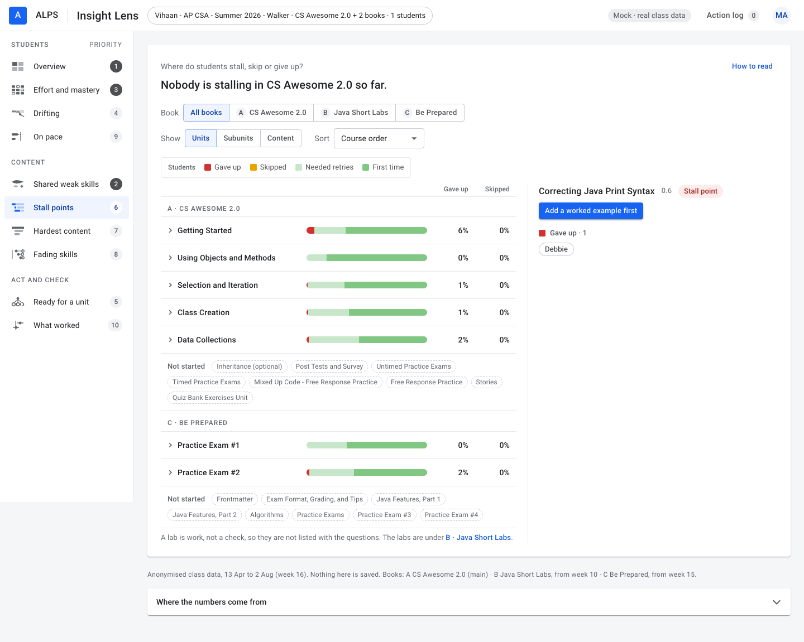
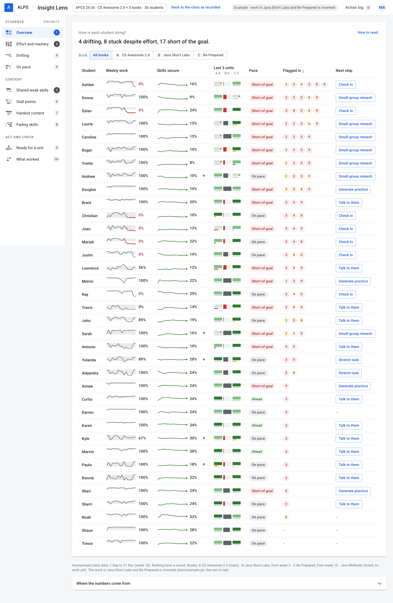
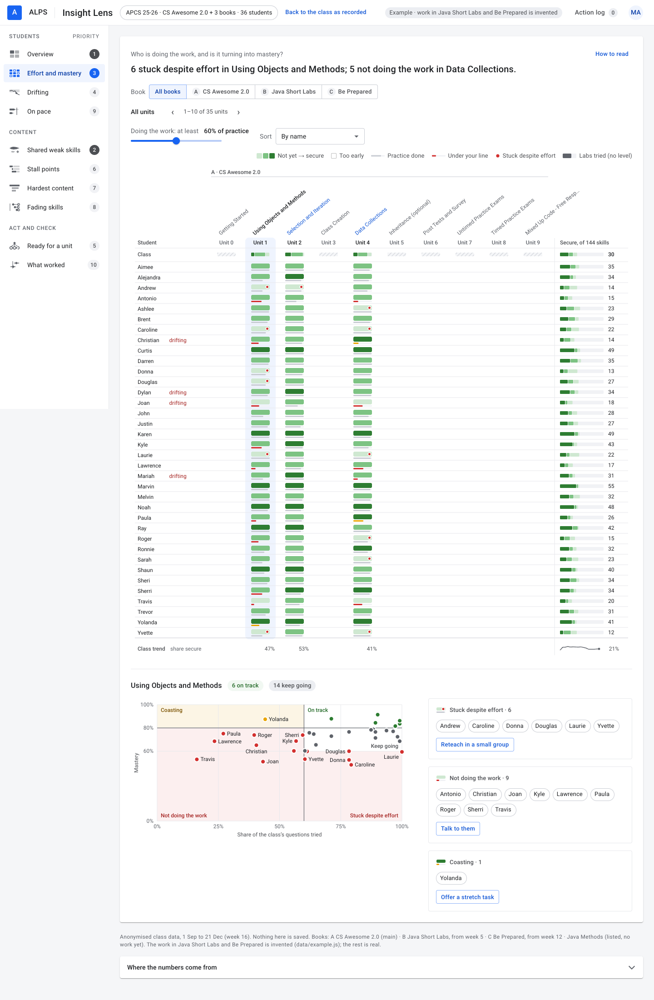
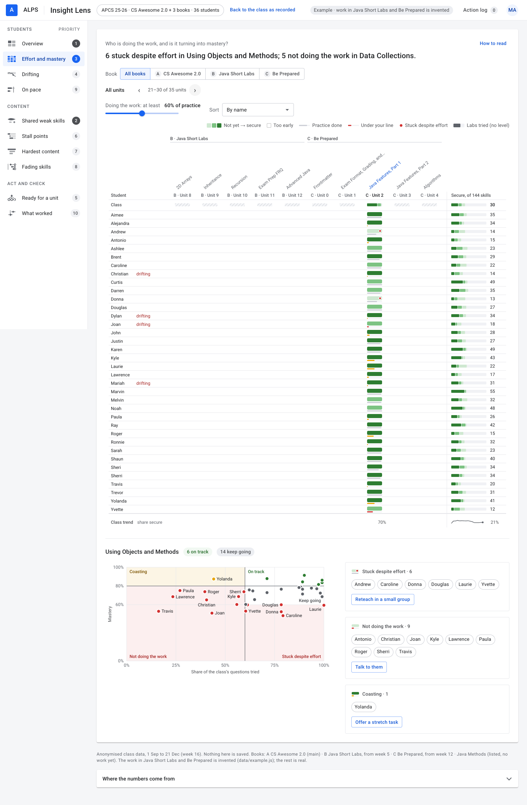
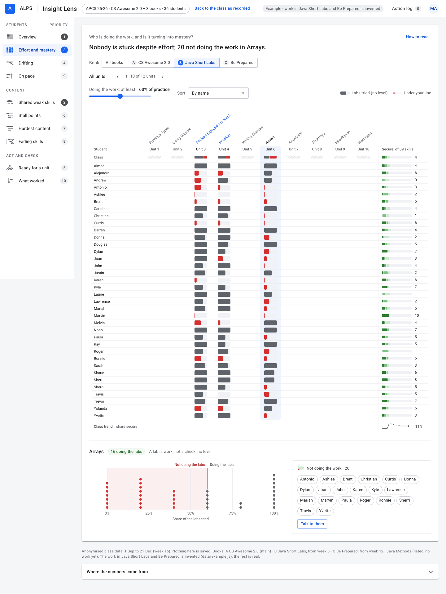
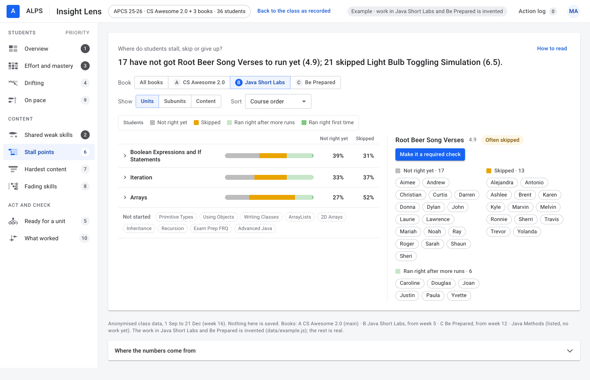
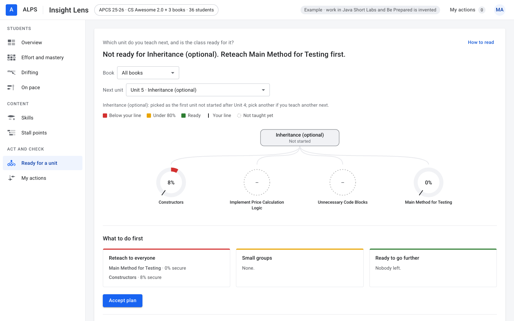
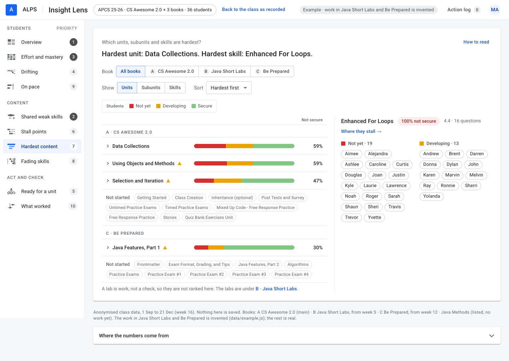
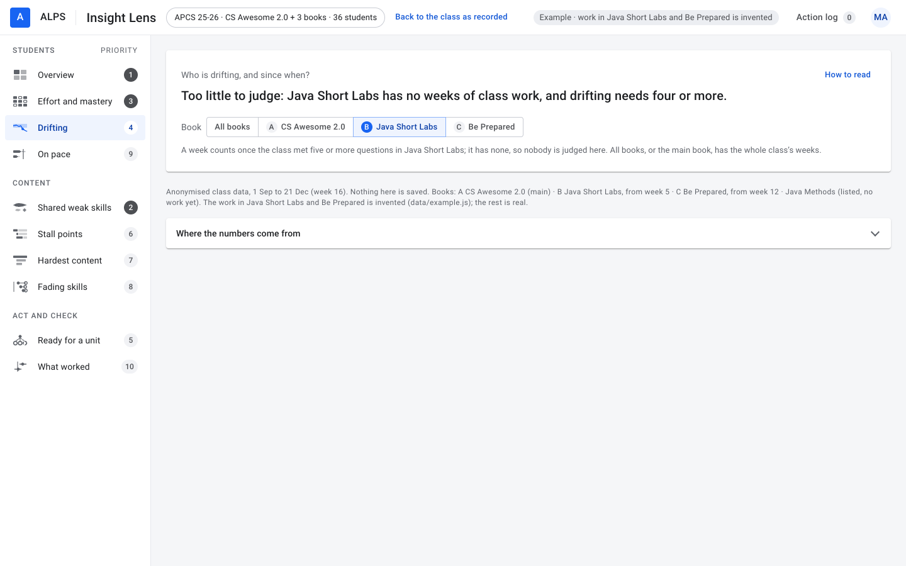
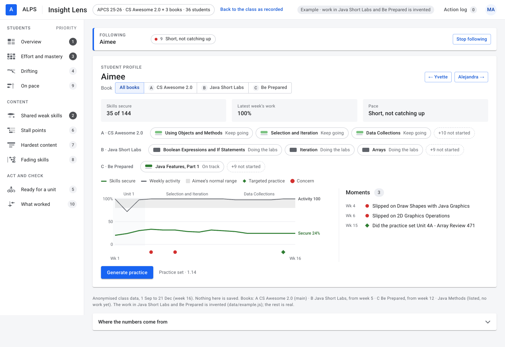

# Insight Lens: a class with more than one book

The question was about the data, not about a page: a section can list more than one textbook, and the mock had only ever drawn a class with one. So the work had two parts.

1. Look in the database (the anonymised copy, read-only) at how sections with more than one book are set up and used.
2. Change the mock so it shows such a class.

## Verdict

**The database says how books are attached to a class. It says almost nothing about how a class uses them.** Of 498 sections that list a book, 29 list more than one. No class with several students has real work in two of its books; the only sections that do have one student each.

**So the mock now does four things.**

- **It draws any class the export gives it**, with one book or several. A real section with three books was exported and drawn, with no change to the pages.
- **It leaves a class with one book exactly as it was.** Every page of the real class is the same, pixel for pixel, apart from one new link in the top bar.
- **It carries one example**, behind that link: the same real class with three more books. Their outlines are real. The work in them is invented, and every page says so while the example is on.
- **It has one book filter**, the same on every page, once two books have work: all the books, or one of them.

Open `index.html?books`, or press "See an example with three more books" in the top bar.

## 1. What the database says

### Where it is recorded

A section lists its books in `section_curriculum`: the book, a role (`primary` or `supplemental`), an order and the date it was added. `section.curriculum_id` still names one book, the first primary.

| | Sections |
|---|---|
| List a book | 498 |
| List one | 469 |
| List more than one | 29 |
| … two books | 12 |
| … three | 8 |
| … four or five | 6 |
| … six, seven and sixteen | 3 |
| List more than one primary book | 4 |

### Who the 29 are

| | Sections |
|---|---|
| Have students | 14 (one with 63, one with 8, one with 5, the rest one to three) |
| No students yet (set up for 2026-27) | 9 |
| Test fixtures | 6 |

The nine with no students show what teachers intend. They pair a textbook with a second textbook (CS Awesome 2.0 with Java Methods, four times), a book of labs, a book of programming assignments, or an exam book: books of one subject.

### How many use more than one

| | Sections |
|---|---|
| Any graded answer in two books | 7 |
| … ten or more answers in each of two books | 4 |
| … and more than one student | 1, a test fixture with fifteen questions answered |

The 63-student class listed two more books on 7 October 2026. They hold two answers between them. **No real class with several students has work in two books.** Everything below is built around that.

### How a class with several books is put together

- **A unit, a lesson and a question belong to one book.** No question sits in two: of 86,755 questions, none is listed by two books.
- **A skill is shared.** The Java books tag their questions from one skill set ("Java Programming 2"). Of the skills Java Short Labs tags, 79% are ones CS Awesome 2.0 tags too; for the exam book it is 73%.
- **Not every book says what it teaches.** CS Awesome 2.0 has 3,478 rows of teaching weights (`unit_skill_coverage`), the exam book 801, Java Short Labs none. A lesson of labs is known only by the skills its labs are tagged with.
- **A supplemental book's units are hidden from students unless assigned** (856 rows of `section_unit_visibility` in five sections, all `hidden_unless_assigned`).
- **An assignment belongs to one book** (`coursework.curriculum_id`). When a book is added, the section gets its assignments.
- **Books are added as the course goes on.** In the section drawn below the course began on 13 April, the labs were added on 16 June and the exam book on 23 July.

### How the one-student sections use their books

Four summer sections, one student each, the same three books: CS Awesome 2.0, Java Short Labs, Be Prepared for the AP Computer Science Exam in Java. The pattern is the same in each.

- **The main book, every week**, from the first.
- **The labs alongside it**, from mid-course: two or three a week, on the topic the main book is on.
- **The exam book at the end**: fourteen questions in the second-last week, ninety-one in the last.

That is the real section drawn by the mock. Its labs are named under the list, because of what follows.

### A lab is not a question

This was not asked, and it decides how a book of labs has to be read.

| | Coding task in the main book | Lab in the labs book |
|---|---|---|
| Whose | the four students, in CS Awesome 2.0 | the same students |
| Student-tasks | 1,376 | 25 |
| Median tries | 1 | 7 |
| Right first time | 62% | 4% |
| Right within three tries | 89% | 16% |
| Ever marked right | 96% | 48% |

The mock gives a coding task full credit when it is right within three tries. By that rule a lab scores about 0.2, and anyone who does the labs would be "not yet" on every skill a lab touches. So a lab cannot be counted as a check on a skill.

## 2. How the mock draws it

Eight rules. Each follows from something in section 1.

### One book: nothing changes

The real class is drawn as before: no book is picked, named or tagged, and no page has a filter. The one new thing is the link to the example in the top bar (in the footer on a phone).

### The top bar counts the books, the footer names them

"APCS 25-26 · CS Awesome 2.0 + 3 books · 36 students". The footer: "Books: A CS Awesome 2.0 (main) · B Java Short Labs, from week 5 · C Be Prepared, from week 12 · Java Methods (listed, no work yet)". **A book with no work is named there and nowhere else.** No page gives it a button or a column.

### Every page has one filter: all the books, or one

The first control under the answer on every page, and under the name on a profile. It keys each book to a letter.

- **"All books" puts the books together.** A page that offers units groups them by book: a label over each book's columns in the grid, a heading a book in an outline, a row of units a book on Ready for a unit, a row of chips a book on a profile. The three unit columns of the overview carry the letter.
- **One book narrows every page to that book**: its units, lessons and questions, the skills its lessons use, and the work done in it.
- **A level does not change with the filter.** It comes from the questions on the skill in every book.
- **Only books with work are on offer.** The pick is in the address (`?book=java-short-labs`), so a link keeps it and Back returns to the book before; a change reloads the page.

### A book of labs is drawn as work, with no level

- **A unit of labs is one gray bar**: the share of its labs tried, red when under the line.
- **No level, and nobody stuck or coasting.** A student is doing the labs, or is not doing the work.
- **Its chart has one axis**: everyone placed by the share of the labs they tried, stacked where shares coincide.
- **Where a question says "gave up", a lab says "not right yet"**, in gray: half of all labs are never marked right, so that is a lab's usual state and the share is what matters.

### A skill is one skill, whichever book checks it

- **Its level counts the questions on it in every book**, labs excepted. Under the exam book, a skill's level still comes mostly from the main book's questions; under the labs, entirely from the other books.
- **The lesson a page names for a skill is the first lesson with a question on it.** A lab is a skill's home only when no such lesson is.
- **A unit can build on skills another book taught.** Ready for a unit judges the exam book's unit on them.

### Under "All books", the labs are named under a list and not ranked in it

Hardest content ranks units by the share of the class not secure on their skills, and Stall points ranks questions by who gave up. Ranked with the questions, the labs would fill the top of both lists. So they are named under the list, with the way to them. Under the labs book, Hardest content lists the skills each lab practises with the class's level on them (from the questions in the other books, and it says so), and Stall points lists the labs.

### The main book sets where the class is

- **Under "All books", the unit the class is on is the main book's.** Ready for a unit opens on it, and the stall flag on a student is about its latest lesson.
- **The bands of time** on Shared weak skills and a profile's timeline are the main book's units. The labs and the exam book run beside them, and their bands would overlap.
- **With one book picked, that book's latest unit is the unit the class is on**, and its units are the bands.

### A page says so when a book has too little to say

- **A week counts once the class met five or more questions in the book.** The labs are two or three a week, so no week counts; the exam book has one.
- **Drifting needs four such weeks.** Under either book the page judges nobody and says why, and the weekly figures on the overview and a profile go blank rather than read as zero.

### A name says its book where books mix

A profile under "All books":

- **A row of chips a book**, the book named once at its left.
- **In a sentence, a unit of another book says its book**: "Not doing the work · Arrays (Java Short Labs)".
- **A lesson code carries its book's letter**: "B · 4.9".

## 3. The example

| | Real or invented |
|---|---|
| The class, its 36 students and all their work in CS Awesome 2.0 | Real, untouched |
| The outlines of Java Short Labs, Be Prepared and Java Methods: units, lessons, questions, skill tags | Real, read from the database |
| The work of the 36 students in Java Short Labs and Be Prepared | **Invented** |
| Java Methods | Listed, and not started: the commonest state of a second book |

The invented work follows section 1.

| | In the example | In the real sections |
|---|---|---|
| Labs: median runs | 6 | 7 |
| Labs: ever marked right | 45% | 48% |
| Labs: right first run | 2% | 4% |
| Labs: right within three runs | 13% | 16% |
| Exam book: right first time | 64% | 65% |
| Exam book: right within three tries | 96% | 97% |

- **Sixteen labs in weeks 5 to 12**, two or three a week, beside the main book's topic: if statements beside Selection and Iteration, arrays beside Data Collections. **Eighteen exam-book questions in week 12**, the last week in which the class met new questions.
- **Each student's invented work follows their own real record**: how much of each week's work they did, how they do on the main book's coding tasks, and how they do on the skills a question checks.
- **It sits only on days the student really worked, in weeks the class really met new questions**, and a student does as much of it as of that week's real work. So nobody's days and nobody's weekly line are invented: the four students who are drifting in the real class are the four in the example.
- **Five students do the main book and leave the labs**: Ashlee, Brent, Curtis, Karen and Marvin. That is the case a teacher most needs to see, so it was put in on purpose.

What the example changes on the answer lines, set against the real class:

| Page | Real class | Example, "All books" |
|---|---|---|
| Overview | 4 drifting, 8 stuck, 18 short of the goal | 4, 8, 17 |
| Effort and mastery | Data Collections: 6 stuck, 5 not doing the work | 6 stuck in Using Objects and Methods; 5 not doing the work in Data Collections |
| Hardest content | Using Objects and Methods; Class Instantiation in Java | Data Collections; Enhanced For Loops |
| Shared weak skills | 26 weak, 5 improving | the same |
| Stall points | 29 gave up at Modulo Operation Patterns | the same |
| Fading skills | 7 of 34 rechecked skills faded | 8 of 39 |
| On pace | goal of 77 skills, 18 short | goal of 104, 17 short |

Two answers move because the exam book's questions are evidence on the main book's skills, as a real exam book's would be: more students are "not yet" on the array skills they check, so Data Collections becomes the hardest unit. On pace counts more skills because the labs and the exam book name skills of their own.

## 4. What it costs

A class with one book pays nothing. The example pays this, on the ten pages and a profile at 1440px:

| | Real class | Example, all books | One book picked |
|---|---|---|---|
| Words | 2,121 | 2,546 | 1,787 to 2,277 |

The 425 words are names: the filter (twelve words a page), the labels and headings of two more books, the footer's list of books, the labs' note under two lists, and a profile's rows.

## 5. Decisions you may want to reverse

- **A lab is not a check on a skill.** The evidence is 25 student-tasks from four students. More data may say a lab can be read.
- **A book of labs is told from its questions**: nine in ten are coding tasks. The database has no field for the kind of a book.
- **A level does not change with the filter.** The other reading is that a picked book shows only what its own questions say. Under it a book of labs has no levels at all and an exam book almost none, which is how such books are used.
- **Every page opens on "All books".**
- **The main book sets where the class is.** A class with two main books gets the first one listed.
- **A book's short name is cut from its title** ("Be Prepared", "Java Methods"). A product would let a teacher name the books.
- **The last three units on the overview, whichever book.** It shows where a student is in each book, at the cost of the main book's earlier units.
- **A change of book reloads the page.** The pick is in the address. In the product it would be a query.
- **The example is not the default.** The real class opens first; the example is one press away.

## 6. Limits

- **No class has done this yet.** The pattern comes from four one-student sections. A class may use two books in ways they did not: half the class on each, or one after the other.
- **The work in the example is invented.** Its pages show how things are drawn. They are not findings about anyone.
- **Nobody is assigned a book in this data.** If a teacher sets the labs for some students only, the rest will show as not doing the work.
- **A book with no skill tags** gives the skill pages nothing. It still has effort, stall points and weekly work.
- **Two books of different subjects** share no skills. The mock draws them, and each skill page then holds two unrelated sets in one list.
- **The days a student worked are not split by book** in the export. Under a picked book the week the class is in is the whole class's.
- **A book of labs has nothing on Ready for a unit**: it carries no teaching weights, so no unit of it is known to build on an earlier one.

## 7. How it was checked

- **The export** writes the real class's file with the same students, units, questions, results and assignments as before; only the order of lessons that share a position changed, now by id, so two runs give one file. The real section with three books exports with every unit and assignment carrying its book (505 results in the main book, 9 in the labs, 85 in the exam book).
- **The real class**: every page pixel-identical to before, in 22 pictures at two widths, apart from the new link (233 by 12 pixels in the top bar; one line in the footer on a phone).
- **The example**: every page at two widths under each of the four choices of the filter, and seventeen opened states (the grid's later pages, a labs unit opened, the outlines opened to their skills and labs, a weak skill, a faded skill, the exam book's and the labs' readiness, a profile with a practice set), with no script error and no page wider than its window.
- **The real three-book section**: every page at two widths, no errors.
- **The project's checker**: 20,918 of 20,918, twenty of them new for the rules above.

## Files

| | |
|---|---|
| `tools/export-atlas.py` | Writes every book a section lists, with a short name each, and the book of each unit and each assignment. A class with one book is written as before. |
| `tools/make-example.py` | New. Builds `data/example.js` from the class file and three real outlines. |
| `data/example.js` | New. The example: real outlines, invented work, and it says so. |
| `js/atlas.js`, `css/atlas.css`, `index.html` | The pages. |
| `tools/check.js` | The rules above, as checks. |
